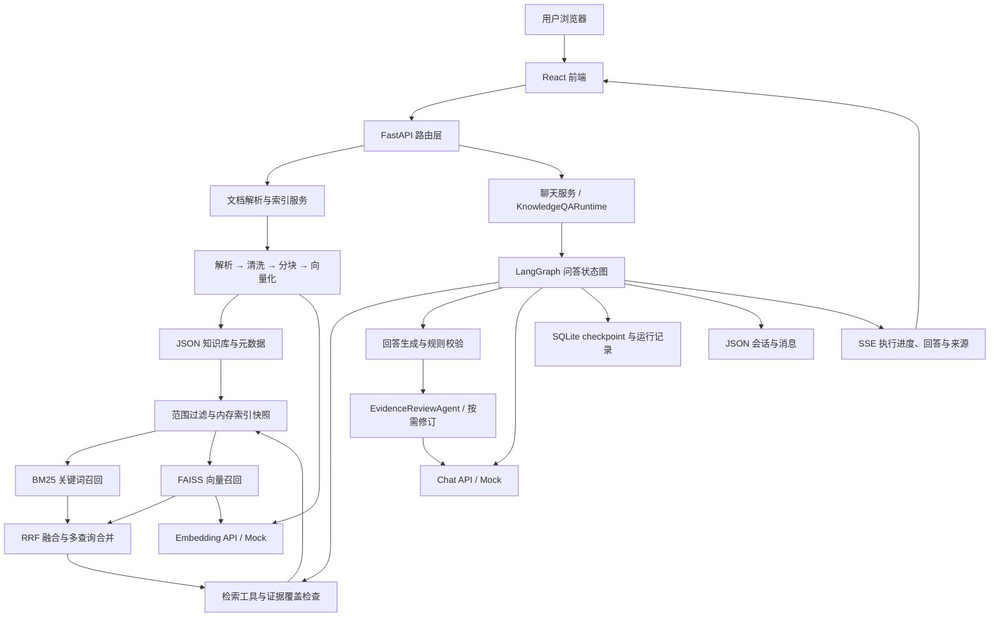
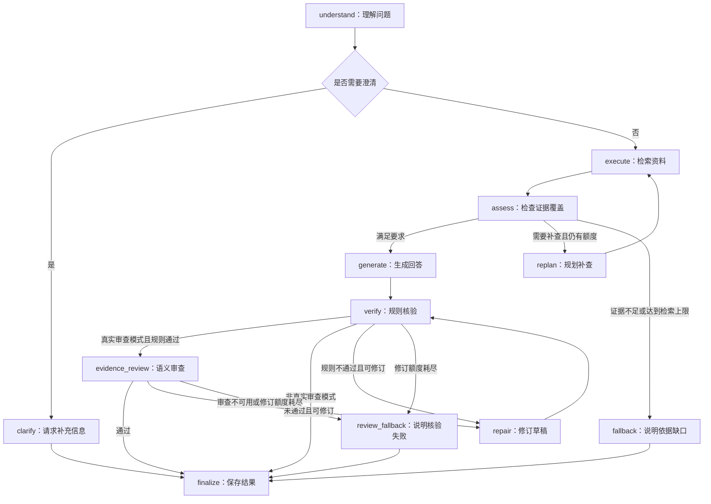
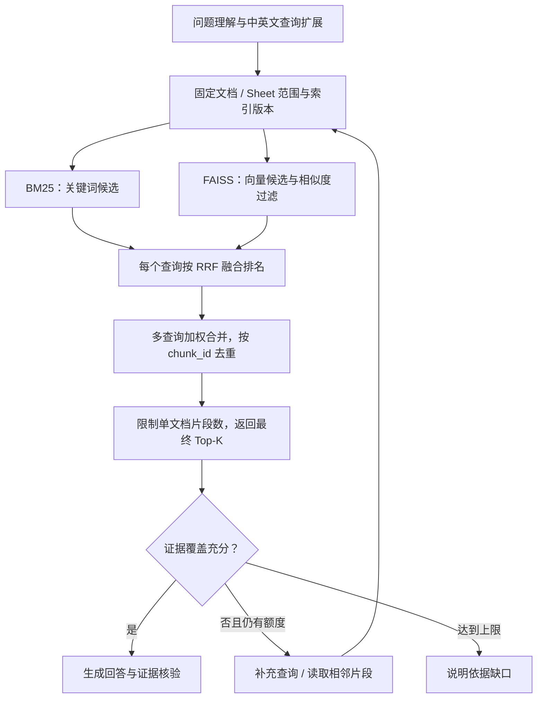

# KnowLoop（知循）：基于 LangGraph 的知识检索与问答系统

## 项目定位

KnowLoop（知循）是一个面向本地资料问答、学习和原型验证的轻量 Web 应用。项目以 **RAG（Retrieval-Augmented Generation，检索增强生成）** 为核心技术路线，默认采用 **BM25 关键词召回 + FAISS 向量召回 + RRF 排名融合**，通过 **LangGraph 状态图**组织问题理解、知识检索、证据覆盖检查、回答生成和证据审查，将 Excel、CSV、文字型 PDF 和 Word 文档接入同一条可追溯的问答链路。

KnowLoop 取自 Knowledge（知识）与 Loop（循环），呼应“检索 → 检查 → 补查 → 核验”的执行流程；中文名“知循”表达循着资料寻找答案。

项目重点实现以下工程能力：

- 将不同格式的文件解析、清洗并转换为带来源元数据的知识片段；
- 结合 BM25 与 FAISS 双路召回，通过 RRF 融合排名，并在召回前限定会话文档和 Sheet 范围；
- 用状态图管理检索、检查和补查，让证据不足时的处理路径清晰可见；
- 将生成回答与证据审查拆开，核对草稿中的结论是否得到本轮资料支持；
- 通过 SSE 向前端展示执行阶段、回答和引用，保留运行记录以便排障。

业务数据保存在本地 JSON 文件中，Agent checkpoint 和运行记录使用 SQLite，无需部署外部数据库或向量数据库。Embedding 与对话模型均通过兼容 OpenAI 格式的接口接入，也提供无需 API key 的本地 mock 模式，适合学习、演示和小型知识库。

## 当前版本状态

| 项目 | 当前状态 |
| --- | --- |
| 默认聊天运行时 | LangGraph `StateGraph`，通过 `CHAT_RUNTIME=langgraph` 启用 |
| 默认检索引擎 | `bm25_faiss`：BM25Okapi + FAISS IndexFlatIP + RRF |
| 问答流程 | 理解问题 → 检索 → 检查证据覆盖 → 按需补查 → 生成与校验 |
| 证据审查 | 默认开启；真实 LLM 模式逐项审查草稿，最多修订一次，再次核验后输出 |
| 数据存储 | JSON 保存知识库、会话与设置；SQLite 保存 Agent checkpoint 和运行记录 |
| 检索索引 | 从 JSON 快照构建内存索引，最多缓存 8 个版本/范围组合，重启后按需重建 |
| 运行方式 | 单后端进程；同一会话同时只处理一个问题 |
| 恢复能力 | checkpoint 用于运行记录与排障，尚无对外断点恢复接口 |
| 兼容回退 | 设置页的 `retrieval.engine=legacy` 回退原检索；`CHAT_RUNTIME=legacy` 回退原问答流程，两者独立 |

当前聊天统一使用知识库问答 Agent。Excel / CSV 作为知识来源参与文档检索；表格分析 Agent、聊天附件及分组、占比、环比等专用数值计算能力已移除。

## 系统功能

| 功能模块 | 说明 |
| --- | --- |
| 文件管理 | 支持多文件与文件夹批量上传、处理进度、内容预览、重新索引和批量删除 |
| 多格式解析 | 支持 `.xlsx`、`.csv`、文字型 `.pdf` 和 `.docx` |
| 检索增强问答 | 支持 BM25、FAISS 及 RRF 混合检索；真实 LLM 模式可扩展中英文检索表达 |
| Agent 编排 | 根据问题生成检索任务，检查证据覆盖并按需补查，展示可折叠的执行进度 |
| 证据审查 | 核对草稿与证据中的条件、否定、主体、数值口径、冲突及任务覆盖情况 |
| 会话管理 | 支持历史会话、新建、重命名和按会话选择检索文档 |
| 来源追溯 | 查看文件、Sheet、行号、原文及命中通道，区分融合排序分、关键词得分和向量相似度 |
| 模型配置 | 可在设置页分别配置 Embedding 与 LLM 的地址、模型、API key 和 mock 开关 |
| 提示词管理 | 支持查看、编辑运行时模板，并校验必需变量 |

## 技术栈

| 层级 | 技术 |
| --- | --- |
| 后端框架 | FastAPI、Pydantic v2、Uvicorn |
| 前端界面 | React 19、TypeScript、Vite、React Router |
| Agent 编排 | LangGraph、SQLite Checkpointer |
| 模型接口 | HTTPX、兼容 OpenAI 格式的 Embeddings / Chat Completions API |
| 检索计算 | FAISS IndexFlatIP、jieba、BM25Okapi、RRF 排名融合、NumPy |
| 文档解析 | openpyxl、PyMuPDF、python-docx、CSV 解析服务 |
| 数据存储 | 本地 JSON、SQLite、本地原始文件 |
| 流式通信 | Server-Sent Events（SSE） |
| 开发与验证 | pnpm、pytest、Node.js Test Runner |

## 总体架构



系统按职责分为四层：

1. **交互层**：聊天、文件库、上传、设置与提示词页面，以及 SSE 事件消费。
2. **接口与服务层**：请求校验、会话管理、文件处理、模型调用和数据读写。
3. **编排层**：LangGraph 节点、条件分支、补查循环与共享执行预算。
4. **数据与模型层**：JSON 知识库、派生的 BM25 / FAISS 内存索引、SQLite 运行记录、原始文件及可替换的模型接口。

## LangGraph 与 Agent 设计

### 问答主链路

一次提问被组织为有状态的执行过程。状态图先检查是否需要澄清，再执行检索；证据覆盖不足时进入补查，达到上限或无法补齐时说明缺口。下面展示默认 LangGraph 链路的主要分支：



图中修订分支适用于真实审查模式；关闭审查或使用 mock 时沿用规则校验路径。预算耗尽会进入对应的终止处理，避免无限补查或修订。

### Agent 职责与代码位置

| 模块 | 主要职责 | 代码入口 |
| --- | --- | --- |
| 知识库问答运行时 | 创建运行、固定文档范围、装配状态图并消费执行事件 | `backend/app/agents/knowledge_qa/runtime.py` |
| 问答状态图 | 定义节点顺序、条件路由、补查和修订循环 | `backend/app/agents/knowledge_qa/graph.py` |
| 问答节点 | 问题理解、证据覆盖、生成、校验与结果保存 | `backend/app/agents/knowledge_qa/nodes.py` |
| 检索工具 | 执行知识检索、读取已命中证据的相邻片段 | `backend/app/agents/knowledge_qa/tools.py` |
| 覆盖检查 | 将问题拆为任务，判断证据是否覆盖所需信息 | `backend/app/agents/knowledge_qa/evidence_coverage.py` |
| 证据审查 Agent | 独立审查答案单元与任务覆盖，返回结构化报告 | `backend/app/agents/evidence_review/agent.py` |
| 共享预算 | 限制模型调用、工具调用与本轮执行耗时 | `backend/app/agents/budget.py` |

### 状态与运行依赖分离

`KnowledgeQAState` 保存问题、检索任务、证据、覆盖报告、草稿、审查记录、修订轮次及最终状态等可序列化数据。服务对象、文档快照和执行预算通过 `RunContext` 注入。

每次提问生成独立 `run_id`，同时作为 LangGraph 的 `thread_id`；业务会话使用 `conversation_id`。本轮补查始终继承已固定的文档范围；运行期间知识库或检索配置发生变化时中止运行并提示重试，避免混用不同版本的证据。

### 证据审查与有限修订

默认 `EVIDENCE_REVIEW_ENABLED=true`。使用真实 LLM 时，草稿先经过规则核验，再由独立的证据审查 Agent 逐项核对。发现问题后最多修订一次，修订后重新执行规则核验和语义审查。

- 审查服务不可用、报告无效或预算不足时，不发布未经核验的草稿，也不标记为审查通过。
- 审查与修订共用本轮预算。正常路径增加一次审查调用；包含修订时，最多增加审查、修订、复核三次模型调用，生成前预留必要额度。
- 单次审查上限为 12,000 字符答案、100 个答案单元、20 个证据片段及合计 24,000 字符证据；超限停止审查，不截断后宣称全量通过。
- mock、关闭审查或使用 legacy 链路时，均标明未进行真实语义审查。

审查判断的是**本轮取回资料是否支持回答**，其范围不包含尚未检索到的全文，也不等同于对事实真实性的外部核实。

## RAG 设计

### 知识库构建

```text
上传文件
  → 按格式解析（Excel / CSV / PDF / Word）
  → 清洗内容并整理表头、段落等信息
  → 分块并保留文件、Sheet、行号等来源元数据
  → 通过 Embedding 接口或 mock 生成向量
  → 将文档、分块、向量及 Embedding 配置标识写入本地 JSON
  → 首次检索时按文档 / Sheet 范围构建 BM25 与 FAISS 内存索引
```

上传后的状态依次为 `uploaded`、`parsing`、`chunking`、`embedding`、`indexed`；解析或索引失败时标记为 `failed`。

### 检索策略

默认使用 `retrieval.engine=bm25_faiss`。普通问题按以下流程检索：



| 策略 | 实现方式 |
| --- | --- |
| 向量检索 `vector` | 使用 FAISS `IndexFlatIP` 检索归一化向量，内积分数对应余弦相似度 |
| 关键词检索 `keyword` | 对文件名、标题、Sheet、列名及正文统一预处理，中文使用 jieba 分词，英文与编号保留为词项，使用 `BM25Okapi` 排序 |
| 混合检索 `hybrid` | 每路最多召回 `max(20, 3 × Top-K)` 个候选，不超过范围内片段数，再用 RRF 融合 |
| 多查询检索 | 每个查询独立融合，按片段去重后取加权最大值；与首个查询语言不同的表达权重为 0.9，同语言权重为 1 |
| 范围与数量控制 | 先按会话文档和 Sheet 构建范围内索引，再召回；合并后限制单文档数量和最终 Top-K |

RRF 按两路候选的名次计算，而不直接相加 BM25 与余弦分数：

```text
RRF(chunk) = Σ 1 / (60 + rank)
```

其中 `rank` 从 1 开始，只累加该片段实际命中的通道。LangGraph 首轮最多使用 3 个查询，证据不足时改写查询或读取命中片段的相邻内容；检索总轮数默认最多 3 轮，仍受本轮预算约束。

### 分数含义与异常处理

新引擎的 `score_threshold` 只作用于向量通道；BM25 的非正分数也可能对应真实词项命中，不能用余弦阈值过滤。RRF 分数仅用于排序，证据门控读取明确的相关性标志，再进行任务覆盖和回答核验。来源保留命中通道、原始分数及排名；历史来源字段仍可读取。

- 混合模式遇到向量服务不可用时降级为 BM25，记录告警，并在有来源时展示原因。
- 纯向量模式遇到服务不可用、无兼容向量或查询向量无效时明确报错。
- 用户取消、预算耗尽和索引版本变化不会作为向量失败静默降级。

### 索引缓存与重新索引

索引服务从本地 JSON 的一致快照建立内存索引，最多缓存 8 个版本/范围组合；缓存键包含数据目录、知识库文件版本、Embedding 身份、检索配置及分词版本。上传、删除和重新索引都会使旧快照失效，进程重启后按需重建。

| 操作 | 行为 | 是否重新调用 Embedding |
| --- | --- | --- |
| 首次查询、缓存失效或进程重启 | 使用已有分块和兼容向量构建 BM25 / FAISS 内存索引 | 构建索引不调用；向量查询本身仍需对问题生成向量 |
| 文件库「更多操作 → 重新索引」 | 按当前分块参数重新解析原文件、生成分块和向量，成功后替换旧数据 | 真实模型模式会调用，mock 模式本地生成 |
| 更换 Embedding 模型、服务地址或 Mock 模式 | 原向量身份不匹配，需对相关文档执行重新索引 | 同上 |

`POST /api/documents/{document_id}/reindex` 与文件库入口执行同一重建流程。普通构建或发布失败时保留原有文档与索引；JSON 批量发布使用同一进程锁并恢复普通 I/O 失败，不提供跨文件的断电恢复事务。旧知识库迁移步骤见[数据存储与升级](#数据存储与升级)。

### 全量扫描与实现位置

需要全量资料支持的任务继续读取范围内全部片段，不受召回 Top-K 和单文档数量限制；系统另行检查扫描上限与回答上下文容量，范围不完整时提示缩小问题。检索分数不能单独证明结论成立，回答仍需证据覆盖与核验。

| 模块 | 代码入口 |
| --- | --- |
| 双路召回、RRF 与多查询合并 | `backend/app/services/retrieval_service.py` |
| 分词、范围内索引、缓存与版本检查 | `backend/app/services/retrieval_index_service.py` |
| Embedding 接口、Mock 与向量身份 | `backend/app/services/embedding_service.py` |
| 上传、删除及文档重新索引 | `backend/app/services/document_pipeline.py` |
| 检索工具与相邻片段读取 | `backend/app/agents/knowledge_qa/tools.py` |
| 相关性门控与回答依据检查 | `backend/app/services/answer_quality_service.py` |

## SSE 流式交互

聊天支持普通请求 `POST /api/chat` 和 SSE 请求 `POST /api/chat/stream`。默认 LangGraph 链路的主要事件如下：

| 事件 | 含义 |
| --- | --- |
| `run_started` | 本轮开始，返回运行与会话标识 |
| `plan` | 已确定的检索任务 |
| `step_started` / `step_done` | 节点执行阶段，用于展示 Agent 进度 |
| `tool_result` | 工具执行状态与命中来源数量 |
| `sources` | 本轮取回的来源信息 |
| `delta` | 回答正文内容 |
| `done` | 最终答案、来源、运行状态与质量报告 |
| `error` | 执行中断或异常信息 |

**真实模型且开启证据审查时，执行进度实时推送，正文在审查与保存完成后一次显示。** 因此正文首包会比直接展示草稿更晚。设置 `EVIDENCE_REVIEW_ENABLED=false` 并重启后端，可恢复原规则校验与实时草稿行为。

## 目录结构

```text
.
├── backend/
│   ├── app/
│   │   ├── main.py                 # FastAPI 应用入口
│   │   ├── routers/                # 聊天、文件、会话、设置与提示词接口
│   │   ├── agents/
│   │   │   ├── knowledge_qa/       # 问答运行时、状态图、节点与工具
│   │   │   ├── evidence_review/    # 证据审查、数据契约与报告校验
│   │   │   ├── contracts.py        # 任务、工具与证据契约
│   │   │   └── budget.py           # 共享执行预算
│   │   ├── services/               # 解析、检索、模型调用、会话与存储服务
│   │   ├── schemas/                # API 请求与响应模型
│   │   └── core/                   # 环境配置
│   ├── scripts/                    # 冒烟测试与专项评估脚本
│   ├── tests/                      # 后端测试与合成样例
│   ├── data/                       # 运行时 JSON 与 agent/ 下的 SQLite
│   ├── storage/original/           # 上传的原始文件
│   └── .env.example                # 环境变量模板
├── frontend/
│   ├── src/                        # 页面、组件、API 调用与样式
│   └── tests/                      # 聊天流与上传队列测试
├── prompts/                        # 系统、查询、回答、补查与审查模板
├── start.sh                        # macOS / Linux 启动脚本
├── start.bat                       # Windows 启动脚本
└── README.md
```

## 快速开始

### 1. 准备环境

准备 Python 3.11、Node.js 和 pnpm。本次前端测试验证使用 Node.js 26.3.1；使用其他版本时，需确认支持测试命令中的 `--experimental-strip-types` 选项。以下启动命令均在项目根目录执行，首次运行需要联网安装依赖。

### 2. 启动服务

**macOS / Linux**

```bash
bash start.sh
```

**Windows（CMD / PowerShell）**

```powershell
.\start.bat
```

脚本会创建或复用 Python 虚拟环境、安装依赖，并在缺少 `backend/.env` 时从模板创建，然后启动前后端。

- 前端：[http://127.0.0.1:5173](http://127.0.0.1:5173)
- API 文档：[http://127.0.0.1:8000/docs](http://127.0.0.1:8000/docs)
- 健康检查：[http://127.0.0.1:8000/api/health](http://127.0.0.1:8000/api/health)

macOS / Linux 按 `Ctrl+C` 同时停止前后端；Windows 分别关闭两个服务窗口。

<details>
<summary>手动启动（分别在两个终端运行）</summary>

后端（macOS / Linux，从项目根目录执行）：

```bash
python3.11 -m venv .venv
source .venv/bin/activate
pip install -r backend/requirements.txt
cp backend/.env.example backend/.env  # 仅首次创建，已有配置时跳过
cd backend
python -m uvicorn app.main:app --host 127.0.0.1 --port 8000
```

Windows 使用 `python -m venv .venv`；PowerShell 激活命令为 `.\.venv\Scripts\Activate.ps1`，CMD 为 `.venv\Scripts\activate.bat`；复制配置使用 `copy backend\.env.example backend\.env`。

前端（从项目根目录执行）：

```bash
cd frontend
pnpm install
pnpm run dev --host 127.0.0.1 --port 5173
```

</details>

### 3. 上传文件并提问

1. 打开「文件库」，上传支持格式的文件，等待状态变为 `indexed`。
2. 进入「聊天」，选择全部文档或指定文档后提问。
3. 查看执行进度和回答，点击来源核对原文；在「设置」调整模型与检索参数，在「提示词」编辑模板。

可将以下内容保存为 UTF-8 编码的 `sales_sample.csv`，上传后提问“上海甲公司的销售额是多少？”。

```csv
城市,公司,销售额
上海,甲公司,12000
北京,乙公司,8000
```

默认 Embedding 与 LLM 均使用 mock 模式，无需 API key，适合验证上传、检索和问答流程。实际语义理解与回答质量需配置真实模型后评估。

### 4. 配置真实模型

在「设置」页分别填写 Embedding 与 LLM 的接口地址、模型名称和 API key，并关闭各自的 mock 开关。

| 配置位置 | 用途 |
| --- | --- |
| `backend/.env` | API key、环境默认值、数据目录、上传上限与 Agent 参数，完整字段见[配置模板](backend/.env.example) |
| `backend/data/config/settings.json` | 设置页保存的模型地址、模型名、mock 开关、检索参数与历史窗口 |

设置页将 API key 单独写入 `.env`。已有运行时设置优先于对应环境默认值，手动修改 `.env` 后需重启后端。切换 Embedding 模型、服务地址或从 mock 改为真实向量后，请在「文件库 → 更多操作 → 重新索引」重建相关文档；不需要先删除原文件。

### 5. 调整检索参数

以下参数在「设置 → 检索参数」中调整，保存在 `backend/data/config/settings.json` 的 `retrieval` 对象中。表中为代码默认值，已有设置及对应环境默认值可能不同。

| 参数 | 默认值 | 说明 |
| --- | --- | --- |
| `engine` | `bm25_faiss` | BM25 + FAISS 新引擎；`legacy` 回退原覆盖率与余弦评分引擎 |
| `search_mode` | `hybrid` | `hybrid` 双路融合；`keyword` 仅关键词；`vector` 仅向量 |
| `top_k` | `5` | 检索服务默认返回数量，可由本轮请求或查询规划覆盖 |
| `score_threshold` | `0.2` | 新引擎仅过滤向量通道，不与 BM25 或 RRF 得分比较；关键词模式不使用 |
| `max_chunks_per_doc` | `3` | 多查询合并后，每份文档最多返回的片段数；`0` 表示不限制 |
| `full_scan_max_chunks` | `200` | 全量扫描覆盖检查的片段数上限，另受回答上下文容量约束 |
| `chunk_size` | `1200` | 分块目标长度，单位为字符；修改后需重新索引已有文档 |
| `overlap` | `100` | 分块重叠目标长度，尽量保留完整行；修改后需重新索引已有文档 |

RRF 常数固定为 60，每路候选数量固定按 `max(20, 3 × Top-K)` 计算，未在设置页单独开放。使用 `legacy` 检索引擎时，三种检索模式及 `score_threshold` 沿用旧评分含义。

### 6. 调整 Agent 参数

以下配置位于 `backend/.env`，修改后重启后端生效：

| 参数 | 默认值 | 说明 |
| --- | --- | --- |
| `CHAT_RUNTIME` | `langgraph` | 可设为 `legacy` 回退原问答链路 |
| `AGENT_MAX_RETRIEVAL_ROUNDS` | `3` | 检索轮数，含首轮，最大为 3 |
| `AGENT_MAX_SECONDS` | `180` | 本轮执行耗时预算，单位为秒 |
| `AGENT_MAX_LLM_CALLS` | `8` | 本轮模型调用预算 |
| `AGENT_MAX_TOOL_CALLS` | `8` | 本轮工具调用预算 |
| `EVIDENCE_REVIEW_ENABLED` | `true` | 是否启用证据审查，真实语义审查需使用真实 LLM |
| `EVIDENCE_REVIEW_MAX_REVISIONS` | `1` | 最大修订次数，仅允许 0 或 1 |

模型与工具调用共用本轮预算，运行库自动创建在 `DATA_DIR/agent/`，无需手动建库。

## 测试与验证

### 后端与前端测试

激活项目虚拟环境后，在项目根目录运行：

```bash
pip install -r backend/requirements-dev.txt
PYTHONPATH=backend python -m pytest backend/tests -q
```

Windows 可先进入 `backend` 目录，再运行 `python -m pytest tests -q`，无需设置 `PYTHONPATH`。

后端测试覆盖文件解析与上传、会话文档范围、消息保存、流式协议、LangGraph 问答、证据审查和提示词契约等关键链路。`test_hybrid_retrieval.py` 与 `test_retrieval_lifecycle.py` 还覆盖真实 BM25 / FAISS 调用、余弦结果一致性、RRF、小语料非正分数、范围过滤、降级、版本失效及重新索引失败恢复；这些回归通过确定性向量或 mock 避免调用外部服务。legacy 与 LangGraph 测试分别显式选择对应运行时。

前端在 `frontend` 目录运行：

```bash
pnpm run test:chat
pnpm run test:upload
pnpm run build
```

### 检索质量与性能对比

激活虚拟环境后，在项目根目录运行：

```bash
# 默认使用 Mock Embedding，验证检索和指标计算流程
python backend/scripts/evaluate_retrieval.py --output outputs/retrieval-mock.json

# 可选：仅发送脚本自带的合成文本到已配置的 Embedding 服务
python backend/scripts/evaluate_retrieval.py --real-embeddings --output outputs/retrieval-real.json
```

脚本在临时知识库中对比新旧引擎，不改写业务文档和会话。当前样例包含 8 份合成文档、16 个问题；输出 Recall@K、MRR、无关结果比例、无答案问题的空结果比例，以及逐问题的预期和实际召回。

`--top-k` 默认 3；`--benchmark-chunks` 默认 1000。性能基准使用合成随机向量，记录首次检索及 10 次热检索的 P50 / P95；两种引擎共用预计算查询向量，计时排除查询向量 API 耗时。向量矩阵字节数不包含 BM25、Python 对象、解析 JSON 和其他缓存占用。

默认 Mock 评估只验证流程；合成样例标签是作者预期，真实 Embedding 的单次评估也不代表业务准确率。模型调用、生成和证据审查耗时不包含在上述检索基准中。

### 冒烟验证

`backend/scripts/smoke_test.py` 依赖根目录的 `samples/sales_sample.csv`，该样例目录未随仓库提交。使用前需自行创建目录，并将快速开始中的 CSV 内容保存到该路径，再在项目根目录运行：

```bash
python backend/scripts/smoke_test.py
```

成功输出 `smoke test passed`。脚本临时切换为 mock 模式，验证上传、索引、问答和消息保存，正常执行结束后清理测试文档与会话并恢复设置。

### 真实模型证据审查评估

配置真实 LLM 后，可在根目录运行：

```bash
python backend/scripts/evaluate_evidence_review.py --output evidence-review-results.json
```

脚本使用 30 条合成标注样例评估审查效果，可追加 `--limit 2` 先做连接检查。脚本在临时数据目录复制模型设置，发送合成输入，不写业务文档和会话；结果文件不包含 API key。单次合成评估结果不代表真实业务准确率。

## 数据存储与升级

- 默认 `backend/data/knowledge/` 保存文档、分块与向量等知识库数据，`conversations/` 保存会话与消息，`config/` 保存设置。
- `backend/data/agent/` 保存 SQLite checkpoint 与运行记录；上传原始文件保存在 `backend/storage/original/`。
- 升级旧版数据前，停止后端并备份 `backend/data/` 和 `backend/storage/original/`。首次启动会将旧根目录中的 JSON 自动迁入对应子目录；新旧位置存在同名文件时会报错，需核对并解决冲突后再启动。

升级到 BM25 + FAISS 检索引擎后：

1. 安装更新后的后端依赖并重启服务；设置页的检索引擎默认使用 `bm25_faiss`。
2. 确认 Embedding 模型、服务地址及 mock 状态。新上传的文档会保存 `embedding_profile`，用于校验向量空间身份。
3. 旧向量缺少完整的配置标识时，不会自动重新调用模型或改写原数据。混合模式先使用 BM25，纯向量模式提示不可用；在「文件库 → 更多操作 → 重新索引」逐个重建即可。
4. 重新索引使用保留的原始文件及当前分块配置，真实模型模式会调用 Embedding API。成功后替换对应文档的片段和向量；构建或普通发布失败时保留旧数据，运行中的相关问答可能因版本变化而需要重试。
5. 需要对比或回退时，在设置页选择 `legacy` 检索引擎。此操作不删除文档、不修改历史来源，也不切换 LangGraph 问答运行时。

仓库的 `.gitignore` 已排除 `.env`、运行数据和上传原件。用于演示的资料应自行准备；提交改动前检查是否夹带密钥或业务数据。

## 当前限制

- JSON 数据源和内存索引适合小规模使用；FAISS 当前使用精确遍历的 `IndexFlatIP`，未使用 HNSW / IVF 近似索引，不适合直接扩展到大量文档与高并发写入。
- 索引尚未持久化，首次查询及版本失效后需要构建；不同范围的缓存会增加内存占用。
- Agent 当前支持单后端进程；JSON 消息与 SQLite 没有跨存储事务，网络重试不保证自动去重，checkpoint 尚不提供对外恢复接口。
- mock 用于流程验证；复杂任务的语义理解、冲突检查和答案质量需使用真实模型评估。
- 不支持 `.xls`、`.doc`、扫描版 PDF 和图片 OCR；复杂 PDF 版面、Word 浮动对象及多级表头可能解析不完整。
- Excel 读取已有单元格值，不执行公式计算；当前不提供专用的表格数值计算工具。
- JSON 批量发布不提供跨文件断电恢复事务；更换向量模型后需重新索引已有资料，单纯重建内存缓存不能转换旧向量空间。

## 相关文档

- [提示词说明](prompts/README.md)：运行时模板、变量契约与维护约定。
- [后端配置模板](backend/.env.example)：环境变量、模型配置与 Agent 开关。

本地工作区如保留 `docs/` 和 `开发文档/`，可继续查阅批量上传、文件预览、聊天交互及 LangGraph 实施记录。这两个目录当前被 `.gitignore` 排除，克隆仓库后不保证存在。
