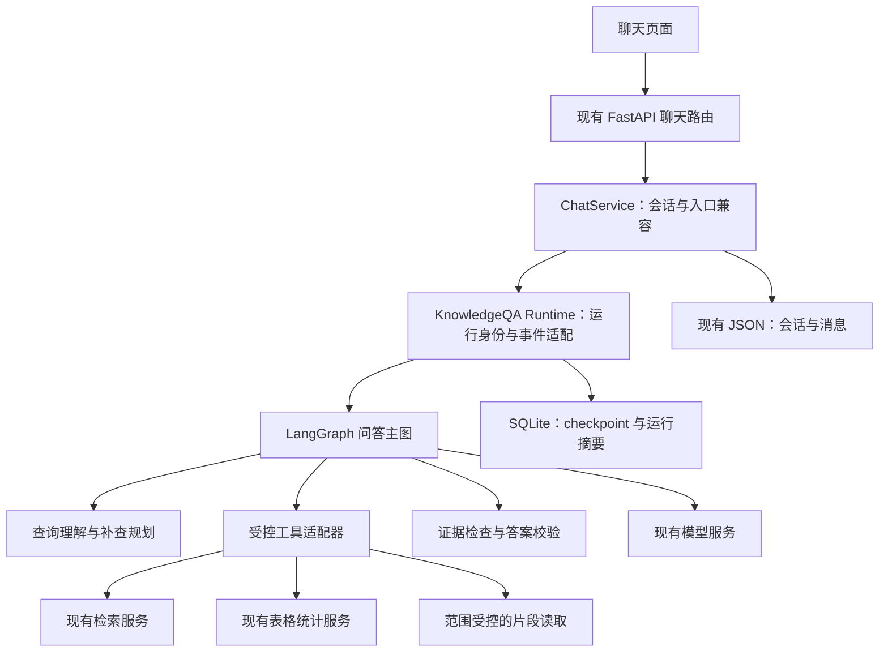
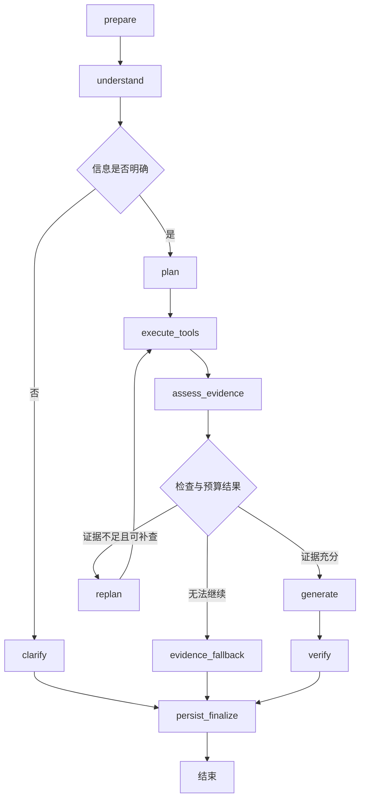

# rag-agent：LangGraph 知识库问答 Agent 一期实施方案

日期：2026-10-17  
状态：一期代码已落地；实际验证与边界见同目录《LangGraph知识库问答Agent一期实施记录.md》  
适用项目：`/Users/stuhua/Desktop/code file/rag-agent`  
参考项目：`/Users/stuhua/Desktop/code file/knowflow-agent`

> 本文保留编码前的设计方案与验收目标。编写方案时仅进行了源码分析；后续经用户明确授权已实施一期代码。下文的新模块、参数与验收项应结合实施记录核对，设计目标不等同于已验证的产品效果。

## 1. 方案结论

采用 **FastAPI + LangGraph StateGraph + 现有业务服务 + Pydantic**，第一期实现一个“知识库问答 Agent”，支持问题理解、查询拆分、知识库检索、证据检查、有限补查、回答生成和答案校验。

第一期的关键变化是：现有查询规划执行一次；新流程根据检索结果判断缺少哪些证据，再在用户选择的文档范围内补充检索。首轮检索之后最多追加两轮补查；信息仍不足时明确说明缺口。

保留当前聊天入口、文档管理、模型设置、引用展示和已有确定性表格统计能力。先完成一个可验证的问答闭环，再扩展表格分析、文档对比和报告生成子图。

## 2. 背景、依据与现有边界

### 2.1 已确认的项目现状

| 方面 | 当前实现 | 对本方案的影响 |
|---|---|---|
| 后端 | FastAPI、Pydantic v2 | 可直接在服务层接入图运行器 |
| 前端 | React、TypeScript、Vite | 扩充 SSE 消费和消息状态即可 |
| 数据 | 本地 JSON 保存知识库、设置、会话和消息 | 暂不迁移业务数据；图状态单独持久化 |
| 模型 | `llm_service` 通过 httpx 调用兼容接口，支持 mock | 继续复用；图编排不强制模型原生工具调用 |
| 问题理解 | 指代补全、子查询、双语检索表达、澄清和规则回退 | 作为初始规划能力复用 |
| 检索 | 扫描本地索引数据，向量、关键词及混合模式 | 首期保留算法，限制补查产生的扫描次数 |
| 表格统计 | Decimal 计算求和、平均、计数、分组排名和时间分组汇总 | 保留现有路径，不承诺任意复合分析 |
| 质量检查 | 证据数量、相关性、范围完整性，以及部分数字、实体和文件名规则校验 | 继续复用，另补任务级证据覆盖检查 |
| 会话范围 | 服务端控制 `document_scope`，历史按 `scope_revision` 隔离 | 补查、统计、元数据和引用必须继承相同约束 |
| 流式回答 | `sources / delta / done / error`；最终 `done.answer` 替换草稿 | 新事件向后兼容，最终答案语义不变 |

当前主调用链：

```text
POST /api/chat 或 /api/chat/stream
  → ChatService.ask / ask_stream
  → 校验会话与文档范围，准备历史与元数据
  → QueryUnderstandingService.plan
  → TableAnalysisService.analyze 或 RetrievalService.search_multiple
  → AnswerQualityService.evaluate_evidence
  → LlmService 生成答案，或使用确定性统计结果
  → AnswerQualityService.verify_answer
  → 保存消息与质量报告
```

### 2.2 本期要补齐的缺口

1. 缺少按执行结果再次决策的闭环，证据不足时通常直接结束。
2. 同步和流式入口各包含编排逻辑，扩展时容易出现行为不一致。
3. 缺少本次运行的结构化状态、步骤轨迹、补查计数和终止原因。
4. 现有基础证据检查不能可靠判断“甲公司的付款条件”等具体任务项是否得到支持。公司名称出现，不等于付款条款已经找到。
5. 前端当前主要消费正文与来源，实时完成回调未接收完整质量信息。

### 2.3 knowflow-agent 中值得借鉴的设计

- 使用 StateGraph 组织明确步骤、条件分支和有限循环。
- 工具与编排分离，复杂业务流程可以逐步成为子图。
- 可序列化的 State 与模型客户端、连接、回调等运行依赖分离。
- 关键错误明确失败；达到轮次上限不伪装成质量检查通过。
- 图 checkpoint 与会话历史承担不同职责。

本期不整体复制 knowflow-agent 的大型运行时、认证体系、历史兼容链路、公文角色或完整恢复基础设施。rag-agent 继续使用自身的服务与数据契约。

## 3. 目标与范围

### 3.1 一期交付能力

| 能力 | 用户可见行为 |
|---|---|
| 多轮问题理解 | 对“那乙公司呢”等追问结合当前范围内历史补全；无法确定时澄清 |
| 有限查询拆分 | 将明确的多对象、多要点查询拆成可跟踪的检索任务 |
| 证据覆盖判断 | 识别各任务项已找到、缺失或存在冲突的证据 |
| 自动补查 | 针对缺口改写查询或读取命中片段附近内容 |
| 有限终止 | 达到补查、工具、耗时或上下文预算后停止 |
| 有来源的回答 | 使用本次实际取回的资料生成答案，并保留来源定位 |
| 原有统计兼容 | 原有可识别的表格统计继续采用确定性计算 |
| 可见执行进度 | 展示理解问题、检索、补查、生成、校验和结束状态 |

### 3.2 一期不包含的能力

独立表格分析 Agent、任意跨表关联与公式执行、独立文档对比 Agent、报告写作与多轮修订、联网搜索、外部系统写入、通用代码执行、知识库自动修改、跨会话长期记忆和多 Agent 并行执行均放在后续阶段。

一期可以回答证据明确的简单条款对比，但不承诺完整合同审查、逐条版本差异检测或法律意见。图 checkpoint 首期用于持久化和故障定位；对外开放暂停、恢复和 SSE 断点续传接口属于后续范围。

## 4. 技术选型与总体架构

### 4.1 技术决策

| 部分 | 决策 | 理由 |
|---|---|---|
| 编排 | LangGraph `StateGraph` | 适合现有确定性步骤与模型决策混合的流程 |
| 业务结果与参数 | Pydantic 校验 | 限制工具、输入、任务数量与结果结构 |
| 图状态 | 定义明确字段的 TypedDict，入图前及关键边界做校验 | 便于状态合并与检查，避免把运行对象写入 checkpoint |
| 模型集成 | 现有 `llm_service` | 保留设置页、兼容接口与 mock 能力 |
| 工具集成 | 普通 Python 适配器与显式注册表 | 复用现有服务，统一输入输出与范围控制 |
| 图 checkpoint | SQLite checkpointer | 适合初期本地、单进程部署 |
| 运行摘要 | 小型 SQLite 运行记录表 | 保存状态、版本、预算摘要与终止原因 |
| 部署 | 继续使用现有 FastAPI 服务 | 不新增独立 Agent Server 或云部署依赖 |

实施时增加 `langgraph` 与 `langgraph-checkpoint-sqlite` 直接依赖，按解析结果锁定兼容版本；是否显式锁定底层 checkpoint 包由依赖管理策略确定。本次未安装或进行兼容性实验，因此不宣称某个版本组合已经验证。应检查与现有 Python 3.11、Pydantic 和 HTTP 依赖的兼容性。

LangGraph 可独立用于编排，不要求业务层直接使用 LangChain 的模型和工具封装。第一期继续通过现有模型服务输出结构化计划；模型不支持原生工具调用时也可使用该流程。

### 4.2 组件关系



运行器与依赖容器可以共享；每次运行的状态、证据、预算和回调必须独立。可变的用户上下文不放进全局 Agent 单例。

## 5. 图流程与节点职责

### 5.1 图结构



工具或关键持久化异常由运行器转为失败状态及 `error` 事件，不能通过普通兜底路径伪装成正常完成。图示中的条件路由由代码执行，不由模型任意跳转。

### 5.2 节点契约

| 节点 | 职责 | 模型调用与边界 |
|---|---|---|
| `prepare` | 接收已校验的会话快照，建立运行身份、历史、范围和预算 | 不调用模型；HTTP 必须在发送 SSE 头前完成范围校验 |
| `understand` | 补全问题，确定是否澄清，得到初始查询计划 | 复用现有规划服务；与 `plan` 共用产物，避免重复做一次完整规划 |
| `clarify` | 生成针对缺失对象、时间或指标的澄清问题 | 不检索、不生成事实答案；下一次用户回复作为新运行 |
| `plan` | 将初始产物规范化成受控工具步骤与证据需求 | 原则上代码归一化；限制白名单、参数与数量 |
| `execute_tools` | 执行当前检索、片段读取或已支持的统计 | 首期串行；所有工具通过相同范围检查 |
| `assess_evidence` | 合并去重结果，检查基础证据及任务覆盖 | 先规则；语义覆盖不明确的复杂问题可做一次受限模型判断 |
| `replan` | 只针对未覆盖项生成补查步骤，过滤重复操作 | 规则优先；必要时调用一次受限模型；不重新理解整段会话 |
| `generate` | 基于选入上下文的证据或确定性结果产出回答 | 模型回答保留真实流式；确定性统计无需新增生成调用 |
| `verify` | 检查回答与证据、数字和来源关系 | 复用规则校验；一期不新增写作修订循环，失败沿用安全替换策略 |
| `evidence_fallback` | 明确依据不足、覆盖不完整或预算耗尽 | 使用受控模板，保留相关来源与缺失项 |
| `persist_finalize` | 保存唯一最终回答和质量摘要，更新运行终态 | 成功写入后才发送最终 `done`；失败发 `error` |

同步与流式调用共用同一套图节点和最终结果构建器。同步入口使用相同流式生成适配器在服务端收集正文，流式入口实时转发，以免出现两套生成、校验和保存流程。

## 6. 状态与数据契约

### 6.1 运行身份

| 字段 | 含义 |
|---|---|
| `conversation_id` | 现有聊天会话 ID |
| `run_id` | 服务端为每次新请求创建的唯一运行 ID |
| `thread_id` | 一期使用 `run_id` 作为 LangGraph checkpoint 身份 |
| `workflow_version` | 图结构和状态契约版本，如 `knowledge-qa-v1` |
| `scope_revision` | 本轮开始时固定的会话文档范围版本 |

历史由现有会话服务加载，不依赖同一 `thread_id` 累积多轮对话。用户重试发送是一次新运行；一期不承诺网络重试自动去重，也不把“存在 checkpoint”表述为已经提供恢复接口。

### 6.2 核心 State

| 字段组 | 建议字段与作用 |
|---|---|
| 身份 | `run_id`、`conversation_id`、`workflow_version` |
| 范围 | `document_scope`、`scope_revision`、`allowed_document_ids`、`effective_filters` |
| 输入 | `original_question`、`resolved_question`、受长度限制的历史摘要 |
| 理解 | `intent`、`needs_clarification`、`clarification_question`、`query_plan` |
| 计划 | `evidence_requirements`、当前 `steps`、`step_index`、`executed_actions` |
| 证据 | `evidence_items`、`coverage_report`、`retrieval_state` |
| 计算 | `deterministic_result`、计算条件与覆盖范围、参与来源标识 |
| 预算 | `retrieval_round`、`tool_call_count`、`llm_call_count`、运行开始时间 |
| 输出 | `draft_answer`、`final_answer`、`quality` |
| 轨迹 | 有界 `step_records`、`errors`、`stop_reason`、`run_status` |

State 仅保存可序列化内容；不保存密钥、httpx 客户端、数据库连接、生成器、回调或原始文件二进制。证据正文只保存本次需要的有界片段，避免反复保存完整文档。

### 6.3 工具结果

统一返回工具名、执行状态、结构化结果、来源、覆盖说明、耗时和错误码。建议使用 `success / empty / unsupported / error` 四种工具结果：

- `empty`：检索正常完成但没有匹配证据，可以触发补查。
- `unsupported`：例如当前统计工具无法理解复合计算，应澄清或说明边界。
- `error`：接口、数据读取、超时等故障，不能当作没有证据。

每个证据项保留 `document_id`、`chunk_id`、文件名、工作表或位置、正文、召回查询和轮次。按 `document_id + chunk_id` 去重，同时保留命中任务项的关联。

## 7. 工具设计与范围约束

### 7.1 一期工具

| 工具 | 底层实现 | 输入与输出重点 |
|---|---|---|
| `search_knowledge` | 适配 `retrieval_service.search_multiple` | 查询列表、有效过滤器和受限 top_k；返回证据与召回状态 |
| `read_evidence_context` | 新增片段读取适配器 | 只接受已授权文档内的 chunk，按稳定位置读取邻近片段；无稳定顺序时只读指定片段 |
| `analyze_table` | 适配 `table_analysis_service.analyze` | 仅支持现有明确统计；返回确定性结果及完整计算范围摘要 |

证据检查属于图节点，首期不提供给模型作为可任意反复调用的工具。不增加任意 Python 执行或任意文件路径读取工具。

### 7.2 文档范围规则

1. `selected` 模式只允许用户选中的有效文档；`all` 模式在运行开始时解析为当时可用的已索引文档 ID 集合。
2. 服务端范围是唯一权威。模型计划中的 `document_ids` 不作为权限或范围来源，工具实际执行时重新注入固定集合。
3. 检索、元数据、表格统计、片段读取、质量检查和最终引用都受同一集合约束。空集合不得退回全库。
4. 会话在其他窗口切换范围，不改变已开始运行的快照；新请求仍执行现有 revision 校验。
5. 固定 ID 集合只冻结文档成员，不代表冻结文档内容。若运行中发现被依赖文档被删除、失效或版本变化，终止并要求重试；完整索引版本快照留待后续。
6. 原始用户问题和模型补全问题分开记录。补全问题、历史回答和规划文本都不能作为事实证据。
7. 用户明确传入的 Sheet、时间或业务过滤条件不能被补查放宽；工具先应用用户约束，再应用经校验的计划条件。需要改变统计口径时返回澄清，不修改设置页的全局检索配置。

检索正文只作为资料使用。规划、覆盖判断和回答提示词均需明确区分用户任务与文档内容，不执行资料中的“忽略前文”“调用其他工具”等指令；工具白名单和范围检查继续由代码控制。

## 8. 证据检查与补查策略

### 8.1 两层检查

第一层复用 `evaluate_evidence`，检查来源、相关性、全量计算范围和已有规则要求。

第二层新增任务级覆盖表。例如“比较甲公司和乙公司的付款条件”需要分别检查：

证据需求优先复用现有 `sub_queries` 及其对象、指标。确需新增 `evidence_requirements` 时，在同一次初始规划中输出并校验，不另加一次全量理解调用。该字段对旧提示词和旧链路保持可选；缺省时从子查询构建，无法明确拆分的复杂需求保持 uncertain 或澄清，不虚构覆盖标准。

| 任务项 | 状态 | 支持材料 | 下一步 |
|---|---|---|---|
| 甲公司付款条件 | covered | 甲公司合同中的对应条款 | 无 |
| 乙公司付款条件 | missing | 尚无 | 针对乙公司与付款条款补查 |

任务项状态使用 `covered / missing / conflict / uncertain`。模型判断必须指向本轮已取回的证据 ID 和可核对原文；不存在的 ID、无法匹配的摘录及只有主体名的片段不能标为有效覆盖。模型判定仍有误判风险，不承诺完整语义事实证明。

证据预算压缩后应重新核对：被判为 covered 的任务项，其支持材料必须实际进入生成上下文；不能删除唯一支持片段后继续宣称覆盖完整。

### 8.2 补查决策

| 发现 | 允许的补查 | 不允许的处理 |
|---|---|---|
| 缺少某个主体资料 | 用主体名与目标条款生成更具体查询 | 自动扩大文档范围 |
| 命中片段提及附件或上下条文 | 读取相同文档的相关或邻近片段 | 读取未授权文件 |
| 表述不同导致漏召回 | 同义词、双语查询或指定现有检索模式 | 凭空补充条款或改写用户目标 |
| 对象、时间或统计口径不明确 | 返回具体澄清问题 | 多轮猜测用户意图 |
| 证据冲突 | 定向查版本、日期和适用条件；仍冲突则披露 | 静默挑选一个答案 |
| 全量计算覆盖不足 | 请求缩小范围，或说明工具边界 | 将多次 top_k 结果并集当作全量计算输入 |

### 8.3 建议预算

以下为初始建议值，实施后根据样例和延迟评估调整，不是已经验证的性能结论。

| 参数 | 建议值 | 语义 |
|---|---|---|
| `max_retrieval_rounds` | 3 | 首轮加最多两轮补查 |
| `max_queries_per_round` | 3 | 含双语扩展后的实际查询条数 |
| `max_tool_calls` | 8 | 所有工具调用总数，内部多查询另受上项限制 |
| `max_llm_calls` | 8 | 含初始规划、翻译、覆盖判断、补查规划和回答生成 |
| `max_run_seconds` | 180 秒 | 全程共用截止时间；每次 I/O 使用剩余时间约束 |
| `max_evidence_items` | 20 | 进入工作证据集合的片段数 |
| `max_evidence_chars` | 24,000 字符 | 生成上下文证据上限，另需计入历史、提示词及输出预留 |
| `max_replan_attempts_per_round` | 1 | 结构无效后不无限请求模型修复 |

实施时需让查询理解、翻译、Embedding 和答案生成等嵌套调用共同计数，并传递剩余耗时。只在图节点之间检查时间，不能构成有效的全程时间控制；同步 CPU 操作在阶段边界合作式停止，不承诺精确到秒的强制中断。字符上限也不等于通用 token 安全上限，必须结合所配模型的上下文容量检查。

补查轮次在真正开始一轮补查时递增。用“工具名 + 归一化参数 + 固定文档范围”识别重复操作。无新查询、证据集合连续两轮不增长、需求不可消歧或任何预算耗尽时提前停止；即使证据不断增加，也不能突破绝对上限。

## 9. 回答、统计与失败处理

### 9.1 最终状态

| 结果 | 处理 | 结束事件 |
|---|---|---|
| `answered` | 证据检查与答案校验通过，返回答案及来源 | `done` |
| `clarification_required` | 返回缺失对象、时间或口径的问题 | `done` |
| `insufficient_evidence` | 说明哪些需求未获得支持，不生成完整事实结论 | `done` |
| `verification_failed` | 使用受控安全答复替换草稿，质量报告标明失败 | `done` |
| `failed` | 工具、模型、关键数据或持久化故障 | `error`，不再发送成功 `done` |
| `cancelled` | 检测到断连或取消后停止后续调度 | 不发送正常完成事件 |

上表区分“运行得到受控答复”和“答案质量通过”。依据不足、澄清和校验失败可以正常结束一次交互，但不能在质量摘要里标为 answered/passed。

### 9.2 已有表格计算

先保留 `analyze_table` 的现有确定性统计入口。只在工具明确成功时使用其计算答案，不让模型自行补做未支持的计算。

计算结果须记录操作类型、字段、过滤条件、文档范围、参与记录数、关联 chunk 标识和覆盖状态。展示来源可以裁剪，完整计算范围摘要不能由展示条数反推。组合计算、同比环比、跨表关联和复杂缺失值处理进入第二期。

### 9.3 规则回退与运行回退

- 规划模型异常或 JSON 无效：沿用现有规则理解；指代无法补全时澄清。
- 补查规划无效：尝试受控规则改写；没有有效新步骤则结束，不反复修复 JSON。
- 模型覆盖判断不可用：复杂任务保持 uncertain，不标成覆盖通过。
- 检索无结果：可补查；检索服务异常：记录故障并失败。
- 回答模型中途失败：保留前端已收到草稿并标明中断，不保存成最终成功答案。
- 图运行失败后不自动重新执行完整旧链路，避免重复调用与重复保存。

## 10. 接口与前端兼容

### 10.1 HTTP 契约

保持 `POST /api/chat` 与 `POST /api/chat/stream`，保持现有请求字段和语义。响应保留 `conversation_id / answer / sources / quality`，可追加可选 `run_id` 与 `status`。

`ChatResponse` 应显式声明新增字段，避免 Pydantic 响应模型过滤掉结果。`quality` 保留原有 `query_understanding / evidence_gate / answer_verifier`，另加 `agent` 摘要，包括工作流版本、轮次、覆盖情况、工具统计和终止原因。

范围不合法和 revision 冲突在 SSE 建立前返回 HTTP 错误；进入流之后的运行错误走 `error` 事件。

### 10.2 SSE 设计

| 事件 | 处理规则 |
|---|---|
| `run_started`，新增 | 返回运行身份；前端开始进度展示 |
| `plan`，新增 | 展示简短任务计划，不展示模型内部推理 |
| `step_started / step_done`，新增 | 通过 `run_id + step_id` 对应阶段，记录可解释的执行摘要 |
| `sources`，保留 | 补查完成、证据选择稳定后，正文开始前发送一次最终来源集合；兜底或澄清也发送，允许为空 |
| `delta`，保留 | 转发真实正文增量；阶段说明不得混入正文 |
| `done`，保留 | 返回完整最终答案、质量、状态和最终来源；前端以其替换草稿 |
| `error`，保留 | 结束本次运行的错误状态，不随后发送成功 done |

不向前端直接暴露完整 LangGraph State、密钥或模型内部推理内容。原始 httpx 模型流通过自定义事件适配；不假设框架能自动捕获非 LangChain 客户端的 token。

首版推荐沿用项目同步生成器与同步服务，在 LangGraph 自定义流事件中转发 delta；后续若改为异步，应同时改造阻塞 HTTP 与数据库访问，不能仅给入口加 async。

### 10.3 界面行为

新增可折叠执行进度区域，展示“理解问题 → 检索资料 → 第 1 次补查 → 生成回答 → 校验完成”等简短状态。失败、澄清和依据不足有不同文案。

前端请求适配器扩展完成回调，接收 `quality`、`run_id`、`status` 和可选最终来源；历史消息加载能回显运行摘要。保留消息正文与来源面板的既有交互。连接中断后不显示已完成，也不自动重发请求。

## 11. 持久化、生命周期与取消

建议新增 `backend/data/agent/`，保存 SQLite checkpoint 和运行摘要。路径由现有 DATA_DIR 派生，不硬编码用户机器绝对路径。实际使用同步或异步 saver、连接复用方式按所锁版本确定，并在应用 lifespan 中创建和关闭。

首期运行记录只需要身份、会话、工作流版本、状态、开始/结束时间、scope revision、预算摘要和错误摘要；不为此引入完整分布式任务系统。

消息仍由 ChatService/消息仓储统一写入，检索工具和中间节点不各自追加聊天消息。消息附带 `run_id` 与角色；同一运行再次进入保存步骤时先检查对应记录，并在 JSON 存储锁覆盖的读写范围内完成去重。为此需要一个小型原子“检查并追加”接口，不能使用无锁的先查后写。

JSON 消息与 SQLite checkpoint 之间没有跨存储事务。若消息已写入但运行摘要更新失败，保留消息的 run_id，标明待核对状态；后续恢复功能需通过运行身份和最终消息进行对账。第一期只承诺单进程内防止同一运行重复保存，不承诺跨进程严格 exactly-once。

一期以单后端进程为支持前提，同一会话同时只允许一个活跃新运行；第二个请求在发送 SSE 头前返回 409，并在正常结束、异常和连接关闭时释放占用。现有前端对 409 的处理偏向范围冲突，应增加机器可读错误码，区分 `scope_conflict` 与 `conversation_busy`，保留兼容的说明文字。

断连后通过关闭流及取消标记阻止后续工具与写入；正在阻塞中的外部调用可能需等超时后退出，不能宣称立即中止。服务重启后旧 running 记录标为 interrupted/待核对，不自动继续执行。用户可重新提问，公开恢复接口放在后续。

删除会话时需同时阻止对应活跃运行继续保存消息，并清理关联运行摘要与 checkpoint；运行在保存前再次检查会话是否仍有效。checkpoint 保留期限建议初始为 7 天，在启动维护或显式维护入口进行有界清理，避免每次提问扫描全部历史。

## 12. 模块与文件改动计划

下表文件名以项目根目录 `/Users/stuhua/Desktop/code file/rag-agent` 为基准，均是实施阶段的拟议路径。

### 12.1 新增模块

| 路径 | 职责 |
|---|---|
| `backend/app/agents/__init__.py` | Agent 模块入口 |
| `backend/app/agents/contracts.py` | 计划、工具参数、结果、证据覆盖与质量契约 |
| `backend/app/agents/knowledge_qa/state.py` | 问答图状态字段 |
| `backend/app/agents/knowledge_qa/graph.py` | 图拓扑、节点与条件边 |
| `backend/app/agents/knowledge_qa/runtime.py` | 运行身份、单会话占用、预算与事件适配 |
| `backend/app/agents/knowledge_qa/tools.py` | 工具白名单、参数校验及范围注入 |
| `backend/app/agents/knowledge_qa/evidence_coverage.py` | 任务覆盖检查、补查缺口提取 |
| `backend/app/services/agent_run_store.py` | SQLite 运行摘要及 checkpoint 生命周期协调 |
| `frontend/src/components/AgentProgress.tsx` | 执行阶段展示 |
| `prompts/agent/replan.md` | 补查规划提示词 |
| `prompts/agent/evidence_coverage.md` | 按任务项判断证据覆盖的提示词 |

首次实现中允许将很小的辅助函数放在上述文件内，不为每个节点增加一个独立文件。

### 12.2 修改模块

| 路径 | 预计变更 |
|---|---|
| `backend/app/services/chat_service.py` | 接入图运行器，统一消息保存，保留会话管理与旧运行入口 |
| `backend/app/routers/chat.py` | 入口选择、流事件桥接、占用释放及结构化冲突错误 |
| `backend/app/schemas/chat.py` | 追加可选 run_id/status 等响应字段 |
| `backend/app/services/query_understanding_service.py` | 暴露结构化规划结果，兼容可选证据需求，接入共享模型预算与剩余时间 |
| `backend/app/services/retrieval_service.py` | 支持工具适配与受控片段读取，保留原有算法默认行为 |
| `backend/app/services/answer_quality_service.py` | 接收任务覆盖结果，保留原规则与兼容字段 |
| `backend/app/services/llm_service.py` | 扩展可选调用预算、剩余超时与结构化结果辅助，不破坏旧签名默认行为 |
| `backend/app/services/embedding_service.py` | 若包含外部请求，将其纳入剩余时间与取消边界 |
| `backend/app/services/json_store_service.py` | 增加按 run_id 和角色检查并追加的原子接口 |
| `backend/app/core/config.py`、`backend/.env.example` | 增加运行模式、预算及 checkpoint 配置 |
| `backend/app/main.py` | 管理图依赖与 SQLite 生命周期 |
| `backend/requirements.txt` | 增加并锁定已验证的框架依赖 |
| `prompts/query/planner.md` | 在兼容旧字段的前提下，按需增加可选证据需求输出 |
| `backend/app/routers/prompts.py` | 将新增提示词纳入管理白名单、必需变量检查及缓存清理 |
| `frontend/src/api/chat.ts` | 新事件解析、完整 done 结果与错误码消费 |
| `frontend/src/api/client.ts` | 为 ApiError 增加可选错误码，兼容现有 detail 字符串 |
| `frontend/src/types/chat.ts` | 扩展运行摘要和进度类型 |
| `frontend/src/pages/ChatPage.tsx` | 接入进度、质量、忙碌冲突与终态 |
| `frontend/src/components/MessageList.tsx`、相关样式 | 根据现有组件边界嵌入进度与历史回显 |
| `backend/tests/`、`frontend/tests/` | 扩展有业务意义的回归与事件测试 |
| `README.md`、`prompts/README.md` | 记录启用方式、边界和提示词契约 |

不改动 knowflow-agent 业务代码，不迁移现有知识库索引，不改变当前模型或 Embedding 配置值。

## 13. 实施步骤与回退

| 阶段 | 工作 | 阶段完成标准 |
|---|---|---|
| A：契约与骨架 | 锁定兼容依赖，建立 State、工具结果、图和运行记录 | mock 可走通单次检索，范围和错误边界明确 |
| B：现有能力接入 | 接入查询规划、检索、统计、生成和校验；统一同步/流式逻辑 | 原有关键行为与历史消息兼容 |
| C：补查闭环 | 增加任务覆盖、定向补查、重复检测与预算 | 已知缺口能补齐，无资料能在上限内结束 |
| D：交互与持久化 | 进度事件、SQLite 生命周期、消息去重、忙碌与取消处理 | 最终答案一致，异常不误报成功，删除会话不被复活 |
| E：验证与切换 | 回归、独立评估集、真实模型试运行、更新说明 | 达到第 14 节标准后启用新默认模式 |

拟新增 `CHAT_RUNTIME=legacy|langgraph`。实施期间先保持 legacy 默认；验收通过后切为 langgraph。配置未知值或明确启用 langgraph 但依赖、数据库不可用时启动失败，不静默切换。

旧链路保留一个观察周期。回退通过配置切到 legacy 并重启完成，不删除新运行数据；已开始的图运行不在中途换引擎。首次启用前备份现有 data 目录，新旧模式使用同一消息 schema 的兼容可选字段。

## 14. 验收与评估方案

以下测试和评估是实施后的待办，本次未执行。

### 14.1 必须通过的行为验收

| 场景 | 期望 |
|---|---|
| 单条事实问答已有充分证据 | 首轮完成，不无故补查 |
| 甲乙付款条件仅召回甲公司 | 定向补查乙公司，不因为乙公司名称出现就判定覆盖 |
| 两项证据分散在不同文档 | 合并取证并给出各自来源，不将同名文件混淆 |
| 最多两轮补查仍无资料 | 最迟第三轮检索后结束，说明未覆盖项 |
| 重复查询或无新增证据 | 按规则提前停止，不循环消耗预算 |
| 指代无历史或存在多个候选 | 返回澄清，不接受模型虚构的指代补全 |
| 计划含非法工具、虚假证据 ID 或伪造范围 | 拒绝或规则回退，不能执行越界读取 |
| 来源正文包含改变目标或扩大范围的指令 | 按普通资料处理，不影响任务、工具白名单或范围 |
| 只选择一个文档 | 规划元数据、检索、计算和引用都不访问未选资料 |
| 会话范围中途切换 | 当前运行保留原快照，新运行使用新 revision |
| 依赖文档中途删除或失效 | 明确中断，不能把缺失静默当作完整覆盖 |
| 已支持的表格合计、平均、排名 | 与原有确定性结果一致，保持全量计算语义 |
| 全量计算超限 | 不用补查结果并集冒充完整统计 |
| 来源被上下文预算裁剪 | 唯一支持证据被删除时重评覆盖，不生成失去依据的结论 |
| 回答中出现无支持数字或文件名 | 最终安全答复替换草稿，质量报告标记校验失败 |
| 同步与流式相同输入 | 测试模型固定输出时最终答案、来源和质量一致 |
| SSE 真实流式 | 首个 delta 在模型完成及最终校验前到达，done 替换草稿 |
| 模型或工具异常 | error 后无成功 done，已知缺资料与系统故障可区分 |
| 重复进入保存节点 | 同一 run_id 的最终消息不重复写入 |
| 同会话并发、断连、删除 | 正确拒绝或停止，释放占用，删除后不写回会话 |
| 旧消息与旧客户端 | 缺少新增字段可正常读取；旧客户端仍消费原有事件 |

### 14.2 回归范围

优先覆盖现有 `test_document_scope.py`、`test_resolved_question.py`、`test_chat_streaming.py`、`test_prompt_contracts.py` 和 `test_json_store.py` 中的业务契约。图接入后可能调整对私有函数的 mock 接缝，但不能通过削弱范围、流式或质量断言来让测试通过。

新增图路由、补查预算、证据覆盖、运行记录、事件适配和生命周期测试；使用临时存储与固定模型/工具返回，避免测试污染真实数据。前端新增事件解析与终态测试，再执行类型检查和构建。人工浏览器验收包括范围选择、补查进度、来源打开、断流和历史回显。

### 14.3 效果与性能评估

准备至少 20 个带标准答案或证据位置的样例：简单查询 5 个、多轮指代 4 个、多对象/多要点 5 个、无资料或冲突 3 个、已有表格统计 3 个。另保留未用于调整提示词的验收样例，比较 legacy 与 langgraph。

记录答案依据是否正确、任务项覆盖率、错误补全、越界次数、无依据断言、补查有效率、模型/工具调用数、首个进度事件延迟、首个正文延迟和总耗时；有真实 usage 时记录真实 token，无 usage 时明确标为估算。

上线门槛：范围越界、无限循环、同运行重复最终消息和异常后误报成功均为 0；原有确定性统计与关键回归全部通过；补查样例能覆盖预设缺口，无资料样例能有界结束。简单问答不固定增加模型审核调用，延迟和费用变化实测后记录；暂不编造统一准确率或延迟承诺。

## 15. 风险与后续扩展

| 风险 | 应对 |
|---|---|
| 更多检索增加 JSON 扫描和 Embedding 调用 | 受控查询数、同运行缓存、重复检测和总预算；规模增长后再优化索引 |
| 模型错误判断覆盖 | 规则先行、证据 ID/摘录核对、模糊时保持 uncertain |
| 固定 ID 集合无法冻结文档版本 | 运行中检测失效；后续加入索引版本/文档快照 |
| 现有数字规则对复杂结论支持有限 | 保留明确校验边界；后续新增结论与计算结果对应审核 |
| SQLite 与 JSON 无共同事务 | run_id 对账、单进程原子追加、明确故障状态 |
| 同步调用取消不及时 | 传递剩余超时，节点间检查取消，不宣称即时终止 |
| 框架版本和事件接口变化 | 锁定并验证依赖，将事件转换限制在适配层 |
| checkpoint 体积增长 | 有界状态、保留期限、删除会话联动清理 |

第二期实现表格分析 Agent：结构化行存储、明确的计算计划、多步骤结果依赖和比例/增长率计算。第三期实现文档对比与报告生成子图，加入更完整的证据对应和写作审核。公开恢复接口、持久化请求去重、多进程协调及 PostgreSQL 迁移应作为独立工程任务评估。

## 16. 参考与实施前核对

### 16.1 本地源码依据

- [rag-agent 聊天服务](</Users/stuhua/Desktop/code file/rag-agent/backend/app/services/chat_service.py>)：当前同步/流式流程、范围约束及统计入口。
- [rag-agent 查询理解](</Users/stuhua/Desktop/code file/rag-agent/backend/app/services/query_understanding_service.py>)：指代补全、拆分、双语扩展和规则回退。
- [rag-agent 检索服务](</Users/stuhua/Desktop/code file/rag-agent/backend/app/services/retrieval_service.py>)：检索、过滤、全量扫描与来源构建。
- [rag-agent 表格统计](</Users/stuhua/Desktop/code file/rag-agent/backend/app/services/table_analysis_service.py>)：当前确定性计算范围。
- [rag-agent 答案质量](</Users/stuhua/Desktop/code file/rag-agent/backend/app/services/answer_quality_service.py>)：基础证据与规则校验。
- [rag-agent 模型服务](</Users/stuhua/Desktop/code file/rag-agent/backend/app/services/llm_service.py>)：httpx 调用与真实/模拟流式。
- [rag-agent JSON 存储](</Users/stuhua/Desktop/code file/rag-agent/backend/app/services/json_store_service.py>)：进程内锁、原子替换和持久化边界。
- [rag-agent 前端聊天接口](</Users/stuhua/Desktop/code file/rag-agent/frontend/src/api/chat.ts>)：现有 SSE 协议和完成回调。
- [knowflow-agent 当前架构说明](</Users/stuhua/Desktop/code file/knowflow-agent/Agent/docs/current_architecture.md>)：生产主线与历史实现边界；细节以源码为准。
- [knowflow-agent 主图](</Users/stuhua/Desktop/code file/knowflow-agent/Agent/chat_runtime.py>)、[文档子图](</Users/stuhua/Desktop/code file/knowflow-agent/Agent/agents/document_graph_runner.py>)：图编排和运行状态隔离参考。

### 16.2 官方文档

- [LangGraph 概述](https://docs.langchain.com/oss/python/langgraph/overview)：状态图、确定性步骤与模型决策混合，以及独立使用方式。
- [LangGraph 持久化](https://docs.langchain.com/oss/python/langgraph/persistence)：checkpoint 与长期存储的职责、内存/SQLite/PostgreSQL 边界。
- [LangGraph 流式输出](https://docs.langchain.com/oss/python/langgraph/streaming)：图更新与自定义流事件；具体 API 按锁定版本确认。

实施前重新核对工作区改动、所选依赖版本、事件接口和 saver 生命周期。只有获得明确的实施指令后，才开始修改业务代码、安装依赖或执行测试。
