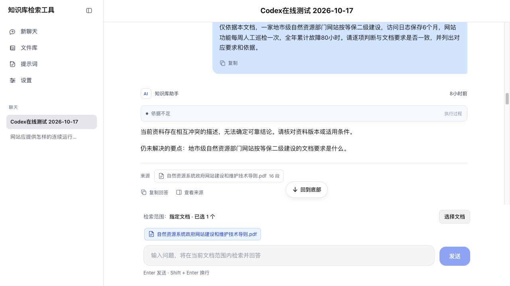
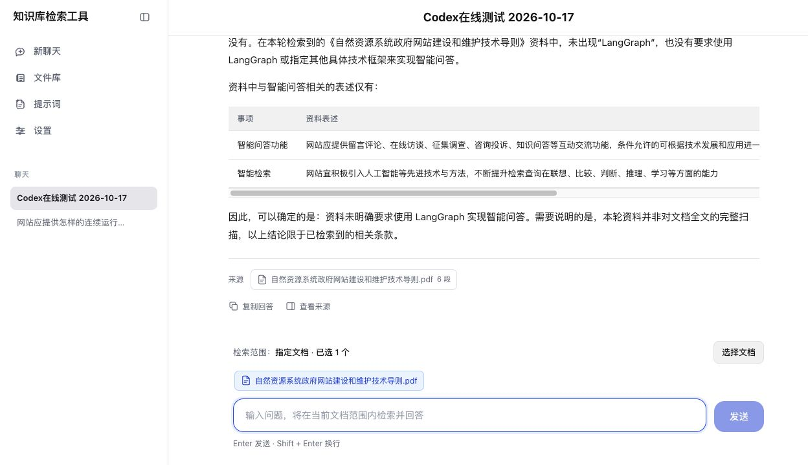

# LangGraph 知识库问答 Agent 在线测试报告

测试日期：2026-10-17（北京时间）。本报告仅评估上传文档问答的实现表现，不认定报批稿的现行效力。

## 结论

通过当前运行的聊天页面，使用真实模型连续提交了10轮问题：**5轮通过、1轮部分通过、4轮未通过**。这是同一指定文档会话的定向探索测试，包含改写和追问，不是独立随机样本，不代表总体准确率。

简单事实、部分跨章节归纳、外链多轮追问及框架要求防编造表现良好；复合任务的证据判断、场景事实与标准要求的区分、封面定位和部分指代理解仍需改进。运行成功或状态为 answered，不代表答案已通过人工完整性验收。

## 环境与方法

- 页面：http://127.0.0.1:5173；后端：8000。没有启动替代服务。
- 模型：deepseek-flash，LLM Mock=false；Embedding：embedding-3，Mock=false。
- 检索：hybrid；Top K=10；score_threshold=0.2；每文档最多6块；full_scan_max_chunks=200；chunk_size=3000；overlap=100。记录测试时读取到的配置，未修改设置。
- 文档：自然资源系统政府网站建设和维护技术导则.pdf；doc_e840aacc1e01；15页、16块。下文页码为包含封面目录的PDF实际页码。
- 会话：[Codex在线测试 2026-10-17](http://127.0.0.1:5173/?conversationId=conv_47930461760f)。已选择仅检索该PDF，与用户原会话分开。
- 所有问题经页面提交，随后只读核对业务消息、run ledger和checkpoint；没有用Mock替代回答，也没有修改答案、业务代码、提示词、索引或运行参数。
- 来源面板可展开并定位对应原文；重新打开页面后10轮问答均持久化存在。中途页面切换至设置页后另开后台测试页继续，未更改设置。
- 耗时以首个checkpoint到终态ledger的时间差估算，接近后端执行耗时，不等于严格的浏览器端到端延迟。

## 结果总表

| 编号 | 测试点 | 人工评估 | 检索轮数 | LLM调用 | 工具调用 | 约耗时/秒 |
|---|---|---|---:|---:|---:|---:|
| T1 | 日志留存与恢复测试合并提问 | 未通过 | 3 | 7 | 5 | 42.6 |
| T2 | 日志留存单独提问 | 通过 | 1 | 2 | 2 | 4.9 |
| T3 | 恢复性测试单独提问 | 通过 | 2 | 6 | 4 | 39.2 |
| T4 | 域名、兼容性、IPv6、HTTPS跨章节归纳 | 部分通过 | 1 | 3 | 2 | 37.9 |
| T5 | 四项建设场景判断 | 未通过 | 3 | 6 | 5 | 71.4 |
| T6 | 封面编号日期及生效状态：省略文件名 | 未通过 | 0 | 1 | 0 | 3.4 |
| T7 | 封面状态：补充完整文件名 | 未通过（防编造通过） | 3 | 7 | 5 | 86.0 |
| T8 | 外部链接增加、删除、日常管理 | 通过 | 1 | 4 | 2 | 30.0 |
| T9 | 商业网站链接多轮追问 | 通过 | 1 | 3 | 2 | 10.6 |
| T10 | 是否指定LangGraph：无依据要求测试 | 通过 | 1 | 3 | 2 | 8.6 |

合计：42次LLM调用、29次工具调用。调用数来自预算计数，不含Embedding计费，也未计算实际费用。

## 主要问题与建议

### 1. 优先修复PDF阅读顺序，再重新解析入库

第12页原PDF中“HTTPS……强化”后紧接“互联网传输安全保护。”；“每年至少开展1次”后紧接“恢复性测试。”。当前入库chunk把这些续行移到了前部，导致T4误报资料缺失，也会增加T1/T3语义覆盖判断难度。

只读使用PyMuPDF get_text('text', sort=False/True)对照，两种提取均能保留上述相邻关系；现有应用的分栏检测/排序应重点检查。相关位置：[pdf_parser_service.py](</Users/stuhua/Desktop/code file/rag-agent/backend/app/services/pdf_parser_service.py:117>)。修复后需重新解析该PDF并重建相关块和向量，单改提示词不足以纠正已入库顺序。

### 2. 区分“待判断现状不符合标准”与“证据相互冲突”

T5的二级建设是用户给定场景，原文三级要求正是判断依据。当前coverage把第14页这一条依据标为conflict，随后3轮检索后拒答。已检索全文16块，其他3项也已covered，继续扩大召回不能解决本例。

建议规划阶段分开保存场景事实与所需标准；冲突判定必须基于相同适用条件下的多条资料，不能因为资料否定用户前提就判为证据冲突。相关位置：[evidence_coverage.py](</Users/stuhua/Desktop/code file/rag-agent/backend/app/agents/knowledge_qa/evidence_coverage.py:51>)、[evidence_coverage.md](</Users/stuhua/Desktop/code file/rag-agent/prompts/agent/evidence_coverage.md>)。当前代码对covered会校验摘录，而conflict没有要求至少两条相互矛盾的有效证据，应补充这一约束。

### 3. 改进任务拆分与部分回答

T1把“请给出依据”拆成第三个独立事实检索任务。它本应属于答案格式/引用要求。两项实质问题单独提问都能回答，合并提问却整体拒答，说明本次复合问法的完成度不稳定。

建议任务拆分区分事实目标与输出要求；逐字引用校验保留，同时支持PDF换行/段落后的证据拼接验证；仍有缺口时展示已证实部分并明确缺口，避免一个不确定项阻塞全部结果。T1的具体uncertain原因尚无原始模型返回日志，不能把所有失败都归为摘录匹配问题。相关位置：[evidence_coverage.py](</Users/stuhua/Desktop/code file/rag-agent/backend/app/agents/knowledge_qa/evidence_coverage.py:31>)。

### 4. 对封面、目录、指定页面增加结构定位能力

T7明确指定文件和封面，3轮检索后的11个来源仍没有第1页，最终未答出封面占位符和报批稿状态。应把“封面”映射到文档首页，结合结构信息读取证据，而不只做语义相似检索。封面的编号和日期较短，索引和检索排序也应覆盖这类信息。

### 5. 唯一选定文档应帮助解析指代

T6在仅选一份文档时用“这份标准/它”，仍被要求明确对象；T9的“刚才”追问则正常继承上下文。说明不是多轮能力全部失效，而是部分指代处理过于保守。建议把所选文档明确作为可解析上下文，按指代的实际对象判断是否需要澄清。相关位置：[query_understanding_service.py](</Users/stuhua/Desktop/code file/rag-agent/backend/app/services/query_understanding_service.py:199>)。

## 执行路径与边界

- T3实际发生了补充检索，并在第2轮形成正确答案，说明补检闭环确实运行。
- T1、T5、T7均在3轮后停止，未发现无限检索。
- T6走澄清分支，未执行工具；其他问题进入检索/评估分支。
- T10正确说明没有检索到指定LangGraph的要求，并明确本轮未全文扫描，未拿项目实现或外部知识冒充上传文档内容。
- 10轮均到达持久化终态，未观察到接口异常导致的中断。未做并发、取消、删除、性能压力、其他文档格式或跨文档权限测试。
- 本次未修复代码或重建文档，不把缺陷发现写成修复完成。

## 页面证据

场景题把“不符合”误判为“资料冲突”：

最后一题的防编造回答：

[来源面板截图](在线测试证据/2026-10-17/source-panel.png) · [场景题执行过程截图](在线测试证据/2026-10-17/scenario-run.png)

## 完整问题、回答与逐项判断

### T1 日志留存与恢复测试合并提问

结果：**未通过**；run_id：`run_8b1f8efe1b16`；状态：`insufficient_evidence`。

问题：

> 网站访问日志和数据操作日志至少保存多久？数据库、备份系统和数据多久开展一次恢复性测试？请给出依据。

预期：第12页9.4：日志不少于1年；数据库、备份系统和数据每年至少开展1次恢复性测试。两项应完整回答并提供依据。

实际完整回答：

当前检索资料不足以支持完整回答。

尚缺少依据：数据库、备份系统和数据多久开展一次恢复性测试；请给出上述保存期限和恢复性测试频率的依据。

核对：第12页已召回；req-1 covered，req-2与req-3 uncertain。规划把“请给出依据”额外拆成独立检索任务。最终3轮后整个问题拒答。单独提问在T2/T3可以答出。

来源页：第12页、第14页、第13页、第3页、第2页、第15页。

### T2 日志留存单独提问

结果：**通过**；run_id：`run_e283f819806a`；状态：`answered`。

问题：

> 网站访问日志和数据操作日志至少保存多久？

预期：日志留存时间不少于1年，依据第12页9.4。

实际完整回答：

网站访问日志和数据操作日志的留存时间应**不少于1年**。

依据《自然资源系统政府网站建设和维护技术导则》“9.4 存储和备份”中的规定：“系统的访问日志、数据操作日志，留存时间应不少于1年。”

核对：正确答出不少于1年，章节和原文正确，来源面板可打开第12页。

来源页：第12页、第1页、第6页、第14页、第13页、第2页。

### T3 恢复性测试单独提问

结果：**通过**；run_id：`run_cc8427cab5a3`；状态：`answered`。

问题：

> 网站数据库、备份系统和数据每年至少开展几次恢复性测试？

预期：每年至少1次恢复性测试，依据第12页9.4。

实际完整回答：

网站数据库、备份系统和数据每年至少开展 **1次** 恢复性测试。

依据《自然资源系统政府网站建设和维护技术导则》“9.4 存储和备份”：在线和近线存储应能够快速恢复应用程序和数据服务；网站数据库、备份系统和数据每年至少开展1次恢复性测试。

核对：第1轮后进行补检，第2轮完成；正确答出每年至少1次。注意：一个表面单问被拆成数据库/备份系统/数据3项任务。

来源页：第12页、第14页、第13页、第3页、第2页、第8页。

### T4 域名、兼容性、IPv6、HTTPS跨章节归纳

结果：**部分通过**；run_id：`run_75e77ec035bf`；状态：`answered`。

问题：

> 请分别整理网站域名、浏览器兼容性、IPv6和HTTPS的建设要求，每项标明对应章节和依据。

预期：覆盖第7页5.3、第11页8.4.1、第12页9.1，保留应/宜/可限定词；HTTPS完整要求包含强化互联网传输安全保护。

实际完整回答：

以下依据《自然资源系统政府网站建设和维护技术导则》整理：

| 建设项 | 对应章节 | 建设要求 | 依据 |
|---|---|---|---|
| 网站域名 | 5.3 网站域名 | 政府网站域名的规划和使用应遵循国办函〔2018〕55号要求，并符合：使用以 `.gov.cn` 为后缀的英文域名和以“.政务”为后缀的中文域名，不使用其他后缀的域名；一个网站宜只注册一个中文域名和一个英文域名，如已有多个符合要求的域名，应明确主域名；自然资源部部属政府网站要使用自然资源部门户网站的下级域名，地方各级自然资源主管部门政府网站参照地方政府的域名管理要求执行；网站各栏目、专题、子站、业务系统等均应遵循和使用本网站的域名规则，不可直接使用或链接IP地址，地址应简短易理解，不应包含空格和特殊字符。 | 《自然资源系统政府网站建设和维护技术导则》5.3；并引用国办函〔2018〕55号 |
| 浏览器兼容性 | 8.4.1 页面兼容性（属8.4 页面开发） | 按照HTML5、CSS及JavaScript等技术标准，网页开发应使用成熟且广泛支持的技术；支持火狐、360、奇安信等主流国产浏览器以及Trident、Gecko、Webkit等不同内核的浏览器，保证页面正常显示；重点关注移动互联应用建设中的浏览器适配问题，及时对各类手机品牌、不同版本号进行测试优化，减少浏览器兼容性问题，确保页面可支持主流语言及平台，可以自适应多种浏览终端。 | 《自然资源系统政府网站建设和维护技术导则》8.4.1 |
| IPv6 | 9.1 基础运行环境（“IPv6访问支持”条） | 网站应提供IPv6访问支持；通过IPv4访问和IPv6访问的网站，内容和布局应保持完全一致；网站的IPv6域名与IPv4域名应为同一域名。 | 《自然资源系统政府网站建设和维护技术导则》9.1 |
| HTTPS | 9.1 基础运行环境（“HTTPS协议支持”条） | 网站应在HTTP的基础上实现HTTPS改进，完成互联网数据传输加密，强化……；该条在“强化”之后的后续内容未提供，资料未展示完整要求。 | 《自然资源系统政府网站建设和维护技术导则》9.1 |

需说明：HTTPS要求中“强化”后的具体内容在本次资料中未完整提供，未作补写。

核对：前三项要求正确；HTTPS给出了加密要求，但声称“强化”之后后文缺失。原PDF有完整后文，实际是入库阅读顺序被打乱。运行状态answered不等于人工验收完全通过。

来源页：第14页、第12页、第11页、第7页、第10页、第15页。

### T5 四项建设场景判断

结果：**未通过**；run_id：`run_6996aba76032`；状态：`insufficient_evidence`。

问题：

> 仅依据本文档，一家地市级自然资源部门网站按等保二级建设，访问日志保存6个月，网站功能每周人工巡检一次，全年累计故障80小时。请逐项判断与文档要求是否一致，并列出对应要求和依据。

预期：全部四项均与本文档要求不一致：地市级以上应按三级；日志不少于1年；网站功能每天不少于1次人工巡检；全年累计故障不超过72小时。依据第12—14页。

实际完整回答：

当前资料存在相互冲突的描述，无法确定可靠结论。请核对资料版本或适用条件。

仍未解决的要点：地市级自然资源部门网站按等保二级建设的文档要求是什么。

核对：全文16块已检索且full_scan_complete=true，仍把第三级要求标为conflict。二级是题目中的待判断现状，不是另一条资料。应输出不符合，实际直接以资料冲突结束；其他3项coverage已covered也未展示答案。

来源页：第14页、第13页、第12页、第6页、第11页、第15页、第10页、第2页、第9页、第8页、第7页、第3页、第5页、第1页、第4页。

### T6 封面编号日期及生效状态：省略文件名

结果：**未通过**；run_id：`run_8762d8e27c61`；状态：`clarification_required`。

问题：

> 这份标准的正式标准编号、发布日期和实施日期分别是什么？能否仅根据这份文档确认它已经正式生效？

预期：已选择唯一文档，应能理解“这份标准”，查看封面后说明报批稿、编号和日期占位符，不能据此确认正式生效。

实际完整回答：

请明确要查询的对象、时间范围和指标，或说明你指的是上一轮的哪项内容。

核对：直接要求澄清查询对象，0轮检索。所选范围只有一份文档，因此本例澄清不必要。不是所有多轮都失败，T9正常。

来源页：无。

### T7 封面状态：补充完整文件名

结果：**未通过（防编造通过）**；run_id：`run_e52fa34728f9`；状态：`insufficient_evidence`。

问题：

> 我指的是已选择的《自然资源系统政府网站建设和维护技术导则.pdf》。请查看封面，说明标准编号、发布日期和实施日期是否已填写，能否仅据此确认正式生效。

预期：封面第1页标明报批稿、TD/T XXXXX—XXXX和XXXX - XX - XX占位日期；不能据此提供正式编号、真实发布/实施日期或确认生效。

实际完整回答：

当前检索资料不足以支持完整回答。

尚缺少依据：查看《自然资源系统政府网站建设和维护技术导则.pdf》封面，标准编号是否已填写；查看《自然资源系统政府网站建设和维护技术导则.pdf》封面，发布日期是否已填写；查看《自然资源系统政府网站建设和维护技术导则.pdf》封面，实施日期是否已填写；能否仅根据《自然资源系统政府网站建设和维护技术导则.pdf》封面所载标准编号、发布日期和实施日期确认该标准正式生效。

核对：3轮检索后仍拒答。最终11个来源未包括第1页封面；没有编造日期，但没有完成本可回答的封面状态问题。属于召回和结构定位问题。

来源页：第2页、第3页、第15页、第14页、第4页、第12页、第8页、第11页、第9页、第10页。

### T8 外部链接增加、删除、日常管理

结果：**通过**；run_id：`run_535152bbc087`；状态：`answered`。

问题：

> 网站外部链接的增加、删除和日常管理有哪些要求？

预期：7.3.3外链增删审查、原则上不链接商业网站、确需链接的提示及检查、外链监测和失效清理，并关联10.4.3(d)。

实际完整回答：

网站外部链接的增加、删除和日常管理要求如下，依据《自然资源系统政府网站建设和维护技术导则》7.3.3“外部网站或资源导引”等条款整理：

| 管理环节 | 要求 | 对应章节/依据 |
|---|---|---|
| 总体要求 | 网站应向社会公众提供与本网站相关的外部网站或资源导引服务，如上级主管部门网站、本级部门或单位便民服务性网站、下属单位网站的链接导航等。 | 7.3.3 |
| 增加 | 外部链接的增加应履行严格审查发布流程。 | 7.3.3 |
| 增加 | 原则上不应添加与网站或所在页面主题无关的外部链接导引，不应链接商业网站。 | 7.3.3 |
| 增加 | 确需链接的，应采取技术措施，在用户点击链接跳转时给予明确提示，并对相关页面内容进行定期检查和监测，避免因内容不合法、不合规或链接失效造成安全隐患或不良影响。 | 7.3.3 |
| 删除 | 外部链接的删除应履行严格审查发布流程。 | 7.3.3 |
| 删除 | 应及时清除不可访问的链接地址。 | 7.3.3 |
| 日常管理 | 应建立外部链接管理和监测工作机制，确保所有链接有效可用。 | 7.3.3 |
| 日常管理 | 外部链接监测可参照10.4.3（d），统一纳入网站运行维护内容；10.4.3（d）涉及对错链、暗链、死链以及网站挂马、内容篡改等内容安全情况进行监测检查、预警和处置。 | 7.3.3；10.4.3（d） |

资料未明确外部链接增加、删除的具体审批层级、审批主体和审批表单等操作细则。

核对：正确组织增删和日常管理要求，保留条件，指出资料未明确审批层级/主体/表单。

来源页：第10页、第14页、第13页、第12页、第11页、第9页。

### T9 商业网站链接多轮追问

结果：**通过**；run_id：`run_3504fa49fd02`；状态：`answered`。

问题：

> 如果确实需要链接商业网站，应该怎么处理？请延续刚才的条款依据回答。

预期：继承上一轮外链主题，保留原则上不应与确需链接的条件，说明跳转提示、审查发布、定期监测及清理；不编造审批主体。

实际完整回答：

依据7.3.3“外部网站或资源导引”，原则上不应链接商业网站；**确需链接的**，应当：

1. 采取技术措施，在用户点击链接跳转时给予明确提示；
2. 对相关页面的内容进行定期检查和监测，避免因内容不合法、不合规或链接失效造成安全隐患或不良影响；
3. 外部链接的增加应履行严格审查发布流程；
4. 纳入外部链接管理和监测工作机制，确保链接有效可用，及时清除不可访问的链接地址；外部链接监测可参照10.4.3（d），统一纳入网站运行维护内容。

需要说明：资料未明确“确需链接”的具体认定条件、审批层级和审批主体等操作细则。

核对：正确承接上一轮条款，答出提示、审查、定期监测和清理，未将例外扩展成无条件允许。

来源页：第10页、第8页、第14页、第11页、第9页、第13页。

### T10 是否指定LangGraph：无依据要求测试

结果：**通过**；run_id：`run_a389d528b955`；状态：`answered`。

问题：

> 《自然资源系统政府网站建设和维护技术导则》是否明确要求使用LangGraph实现智能问答？请只依据已上传文档回答，不使用外部知识。

预期：只依据上传文档说明未指定LangGraph，引用智能问答/智能检索相关条款；避免把可选或宜的内容说成必须。若未全量扫描应说明结论范围。

实际完整回答：

没有。在本轮检索到的《自然资源系统政府网站建设和维护技术导则》资料中，未出现“LangGraph”，也没有要求使用 LangGraph 或指定其他具体技术框架来实现智能问答。

资料中与智能问答相关的表述仅有：

| 事项 | 资料表述 | 性质 |
|---|---|---|
| 智能问答功能 | 网站应提供留言评论、在线访谈、征集调查、咨询投诉、知识问答等互动交流功能，条件允许的可根据技术发展和应用进一步提供智能问答、即时通讯等功能 | 条件允许时的可选功能，未指定技术实现方式 |
| 智能检索 | 网站宜积极引入人工智能等先进技术与方法，不断提升检索查询在联想、比较、判断、推理、学习等方面的能力 | 属于“宜”的倡导性要求，未提及 LangGraph |

因此，可以确定的是：资料未明确要求使用 LangGraph 实现智能问答。需要说明的是，本轮资料并非对文档全文的完整扫描，以上结论限于已检索到的相关条款。

核对：正确否认检索资料指定LangGraph，区分智能问答可选功能与智能检索“宜”，并主动说明本轮未全文扫描。

来源页：第7页、第9页、第10页、第12页、第8页、第14页。

## 原始记录

- [结构化测试记录](在线测试证据/2026-10-17/测试记录.json)：问题、完整回答、人工评价、耗时、来源元数据、query_plan、coverage、retrieval_state和运行摘要。
- [会话原始记录](在线测试证据/2026-10-17/会话原始记录.json)：仅本次新建测试会话的20条业务消息，包含其来源原文和quality；未导出用户原会话，也未导出API Key。

后续修改建议按“PDF排序 → 场景与冲突判断 → 复合任务/部分回答 → 结构定位与澄清”的顺序进行，以本报告10轮原题回归，并对此前失败问法做新会话重复验证。本次尚未验证修复效果。
