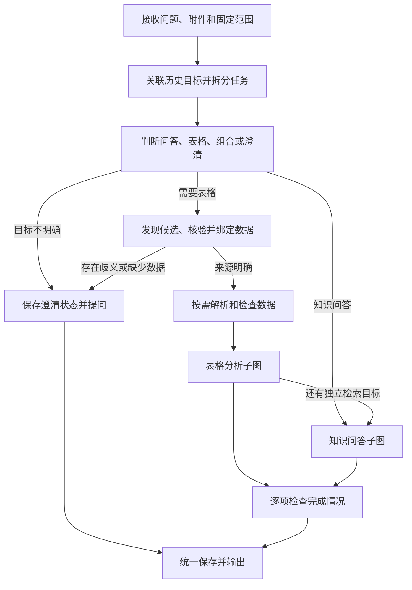

# rag-agent：表格分析 Agent 自动调度与数据发现改造方案

> 历史归档：2026-10-19已按用户要求移除表格分析Agent及自动调度/聊天附件代码。本文记录历史设计与验收，不代表当前功能；参见[移除记录](表格分析Agent移除记录-2026-10-19.md)。

编写日期：2026-10-18。状态：用户已授权，A至D阶段实施及验收完成。

实际实现、验证、启用及边界以[统一聊天实施记录](LangGraph统一聊天与表格自动分析实施记录.md)为准。下文保留实施前方案以便对照。

编写方案时仅进行了只读分析；之后用户明确授权执行，已完成代码、隔离测试、文档与本地配置。本文使用“拟议/建议”等措辞描述原设计，当前能力和限制请查实施记录。

## 1. 先看最终使用效果

用户直接在一个聊天框提问或附上数据。系统理解任务、寻找合适的数据、检查统计口径、调用所需能力并给出结果。用户无需先选择“知识问答 / 表格分析”，无需为了临时分析先去文件库上传，也无需常规操作中手动建立表格索引。

例如：“统计2025年各地区销售额和占比。”系统在当前允许的数据范围内寻找具有日期、地区、销售金额的表格，定位合适的Sheet，读取符合条件的完整记录计算，展示使用的文件、时间范围、口径和原始行。存在两个不同口径的数据源时，才询问应使用哪个。

### 核心交互示例

| 用户输入 | 目标行为 |
|---|---|
| “销售额的统计口径是什么？” | 检索说明文档；不因出现“销售额”就启动表格计算 |
| “统计2025年各产品销售额及占比” | 自动寻找数据、确认字段、筛选、完整聚合、计算占比 |
| 附加Excel并说“帮我分析一下” | 识别Sheet及数据结构，先给概览、质量问题和可开展的分析 |
| 在上题后说“只看华东，改成按产品分组” | 保留已确认的数据和时间条件，修改地区条件与分组，重新计算 |
| “统计销售额，并说明销售制度中的返点规则” | 分别计算和检索，合并回答，分别展示依据 |
| “按返点制度算出实际返利金额” | 先检查是否能明确转换成支持的计算规则；不能时说明缺口，不凭模型推测计算 |
| “2025年销售额”，但有两份不同口径报表 | 展示候选文件及差异，询问使用哪份；不自动混合 |
| 找不到销售数据 | 说明缺少的字段或数据源，支持直接附加文件继续 |

### 本次建议明确的产品决策

1. 默认自动判断任务，移除主流程中强制选模式、选Sheet、建索引的操作。
2. 支持已有文件库、会话Excel/CSV附件、明确格式的粘贴表格三类数据入口。
3. “自动找数据”限定在用户允许的数据范围，不等于访问任意本地文件、数据库或互联网。
4. 每个表格计算任务仍绑定一个明确的数据集版本；首轮改造不自动跨表JOIN、拼接或去重合并。
5. 只在数据来源、字段或统计口径会实质改变答案时澄清，不把后台决策全部交给用户。
6. 保留现有Decimal计算、计划校验、版本和来源能力；新增的是任务调度、数据发现及会话分析能力。

## 2. 为什么需要改造

当前首版完成的是“选定表格后的可靠计算”，尚未完成“自然语言需求到分析结果”的完整流程。

| 已确认的当前实现 | 对体验的影响 | 本次调整 |
|---|---|---|
| `chat_dispatcher.py`按会话的`agent_mode`分发 | 用户承担选择Agent的工作 | 每轮由统一入口理解任务并调度 |
| 表格运行器要求预先存在`table_target` | 不选文件/Sheet就不能运行 | 引入数据发现与绑定节点 |
| 数据构建要求文件库文档`status=indexed` | 临时统计也依赖QA入库和向量化成功 | 分离源文件可用、结构化就绪与QA索引状态 |
| 聊天请求和输入框没有附件契约 | 文件必须经文件库上传 | 新增会话附件入口和生命周期 |
| 上下文主要接续待澄清的问题 | 无法可靠支持任意“只看华东”等分析追问 | 保存结构化分析上下文及条件变更 |
| 两个运行器各自建立运行、保存消息、最终提交 | 不能直接串接两个`open_stream()`处理组合问题 | 引入一次运行、统一提交的主图 |
| QA旧统计路径有统计成功后提前结束的逻辑 | 组合需求可能只完成统计部分 | 统一路径按全部任务验收，不走旧统计短路 |
| 结果读取默认要求文件库文档仍为indexed | 附件/粘贴数据没有适用的来源检查 | 按来源类型核对归属和可用性 |

依据为当前项目文件的只读检查。旧方案中的显式模式适用于前一版范围，本方案拟在统一聊天启用后替代其默认交互。

## 3. 表格分析 Agent 的职责和能力范围

### 3.1 完成一个分析任务

流程包括：识别目标、确定数据、检查质量与口径、生成计划、执行计算、核对任务覆盖、呈现结果与来源、接受连续追问。

它可以处理销售/订单、库存/采购、费用/收支、生产/质量、设备/业务记录等表格。是否支持取决于字段、粒度、单位和计算操作，而非文件名称或所属行业。

| 分析能力 | 本次交付范围 |
|---|---|
| 数据概览 | 文件/Sheet、列及类型、记录数、日期范围、缺失与异常摘要 |
| 条件筛选 | 延续等于、集合、比较、日期区间、非空及AND组合 |
| 基础统计 | 合计、平均、最小、最大、行数、非空数、去重数 |
| 分组、排名 | 延续最多两个分组字段，完整聚合后排序及Top N |
| 占比、派生指标 | 延续明确分母及同表结果上的四则运算 |
| 趋势比较 | 延续自然月汇总和月度环比；不把相邻记录月冒充连续自然月 |
| 质量检查 | 读取错误、缺失、重复候选、混合单位、公式缓存、疑似汇总行；默认不自动清洗或删行 |
| 追问 | 延续/替换筛选、分组、指标与排名条件，保存完整口径 |
| 检索与统计组合 | 本次支持独立说明检索与一个数据集计算的组合；超出算子能力的制度规则执行单独标记 |

“帮我分析一下”默认先生成结构概览、数据质量摘要及建议分析方向。没有明确业务含义时，不把所有数值列都求和，也不把编号、百分比求和结果当作有意义结论。

重复记录可以提示，并提供确认去重口径的入口；不能因为两行相同就直接删除。新增概览统计需有独立的确定性实现和测试，不依赖模型估算。

### 3.2 暂不包含

- 跨文件/跨Sheet JOIN、自动合并相似报表，以及自动消除不同报表间的重叠记录。
- PDF/Word表格提取、图片和扫描件OCR；现有普通文档检索仍可使用。
- SQL数据库、在线表格、互联网取数等外部数据连接。
- 预测模型、复杂异常检测、自动因果归因，以及仅凭数值变化解释业务原因。
- 任意Python/SQL执行、Excel宏及公式重算、写回原文件。
- 同比、季度/周历环比、复杂OR/NOT过滤、多币种自动换算、分段返点规则执行。
- 图表编辑、Excel导出与完整报告生成。这些可在后续能力扩展中单独验收。

用户提出超出范围的问题时，可以完成独立且可靠的部分，但须列出未完成项，不假装整个问题已经解决。

## 4. 数据入口与来源统一

### 4.1 已有文件库

候选只来自本轮固定的文档范围。保留现有全部文档/指定文档约束，发现新候选不能绕过范围。

将“源文件存在且可解析”“表格结构化数据就绪”“知识库向量索引就绪”分开管理。表格计算不以Embedding成功为前提，也不将失败的QA状态伪装成indexed。原文件缺失或无法解析时说明原因。

### 4.2 会话附件

聊天框可添加`.xlsx`、`.csv`，选择后显示文件名、上传/解析状态和移除入口。支持发送“附件+问题”；也支持仅发送附件，此时先返回数据概览并询问分析目标。

附件属于当前会话，不自动出现在公共文件库，不运行Embedding。需要永久复用时，提供明确的“保存到文件库”动作，复用现有入库流程。

建议初始限制：单文件沿用项目上传大小上限；每次最多5个附件且合计不超过100MB，作为可配置保护值。计算仍受现有行数、列数、单元格和分组上限约束；这些数值不是性能保证。

会话附件和已提交的数据快照保留到会话删除，期间可用于追问和历史溯源。“临时”指不入公共知识库，不表示回答结束后立即删除。

未绑定成功、用户未发送或上传中断的文件，在24小时后按记录状态清理。清理需覆盖原文件、目录元数据、结构化版本及未提交结果；删除失败进入可重试记录，启动时只执行有记录的幂等清理。

新聊天先创建会话ID再上传附件。用户取消后产生的空会话可清理，但不得删除已有消息的会话。

### 4.3 粘贴表格

首版支持独立代码块中的带表头CSV或规则Markdown表格。普通叙述、零散数字及不规则对齐文本不自动猜成数据表。

保留用户原文和结构化快照；来源对应输入消息及记录位置。解析不确定时展示解析摘要，要求修正或确认。保留前导零，延续日期、数值精度和单位规则。

粘贴内容同时包含分析问题时，数据块与指令部分分开保存；单元格文字不是执行指令。发现用户意图明确的表格块后解析失败，不能静默忽略数据再回答问题。

### 4.4 来源引用契约

三类来源统一转换为`DatasetRef`，建议包含：

| 字段 | 含义 |
|---|---|
| `source_type` | `library`、`attachment`、`inline` |
| `source_id` | 服务端生成的来源标识；不是客户端传入的文件路径 |
| `owner_conversation_id` | 附件/粘贴数据的所属会话；库文件按文档范围检查 |
| `sheet_key`、`display_name` | 稳定Sheet标识及用户可读名称 |
| `dataset_id`、`version` | 结构化数据版本 |
| `fingerprint`、`schema_hash` | 文件/文本及结构指纹 |
| `availability`、`index_status` | 来源可用性及独立表格索引状态 |
| `provenance` | 旧document_id/sheet_id映射，或来源消息/附件映射 |

服务端验证来源归属，不能接受模型或客户端任意声明dataset_id。会话范围之外的库文件需用户调整范围；本会话主动添加的附件单独列示为本轮授权来源，不因此开放其他库文件。

## 5. 如何根据问题自动找到数据

### 5.1 确定寻找顺序

1. 用户本轮明确指定的文件和Sheet。
2. 本轮附件/粘贴数据，但不能覆盖用户明确指定的其他来源。
3. 当前会话已经确认、且仍适用于本题的分析数据。
4. 允许文档范围内的其他候选。

上述顺序不是无条件选中规则。每个候选仍需满足问题所需字段、业务含义、日期范围和数据粒度。当前表不含所需字段时，不能仅因为上一轮用过它就继续计算。

### 5.2 建立可检索的表格目录

目录保存来源归属、文件/Sheet名称、列名、候选类型、单位、日期范围、行数及粒度提示；不把完整明细放进模型输入。

新来源解析时维护目录。旧库文件首次使用时按需补齐表头和结构摘要，避免要求用户重新上传。目录与数据版本关联，源文件变更后失效并更新。

目录搜索先根据名称、字段和受控别名召回，再用模型理解业务含义及重排。不能仅因包含“金额”就把采购金额当销售额；别名和模型推断都需要结构或数据摘要支持。

元数据缺失的相关候选需要受预算约束地补齐。候选模型输入可分批或压缩，但不能从截断后的前几项推断“全范围只有一个候选”；扫描不完整或仍有同等候选时，返回澄清或搜索未完成状态。

### 5.3 自动绑定与澄清

**自动使用条件**：来源在授权范围内、所需字段及类型满足要求、业务口径和粒度没有实质冲突、候选覆盖检查足以排除其他同等来源。

模型自报的“置信度90%”不能单独作为自动选择依据。服务端记录具体选择理由、已排除候选及缺失信息。

**需要澄清的情况**：销售明细与确认收入表都匹配；多个Sheet分别按不同日期统计；订单数可能指行数或订单号去重；单位或币种不明；只有汇总表但问题需要其不包含的明细维度。

澄清问题应具体，例如：“找到了《销售明细》和《财务收入》，前者按下单日期、后者按确认收入日期统计。你要采用哪一种？”可附可点击候选，用户也可文字回复。

没有满足条件的来源时说明缺少什么，并允许补充附件。未完成搜索、数据确实不存在、字段不够和能力不支持是不同状态，不能混为“没有数据”。

### 5.4 检索定位与完整统计分开

文本/向量检索可用于寻找候选表格或制度说明，不能把召回的Top K片段当完整统计样本。

一旦确定数据，计算必须读取固定版本下符合筛选条件的完整结构化记录。超限或部分解析失败须明确阻塞，不能默默截取前N行后报告全量总额。

## 6. 自动调度与统一LangGraph

推荐新增轻量统一主图，两个现有Agent保留独立目录。主图负责流程与一次运行的生命周期，子图负责各自领域任务；不引入自由协商或多Agent并行竞赛。



此图展示主干；纯表格任务不额外执行QA，纯问答任务不强制找表。“包含统计关键词”只是线索，不是分流判据。任务分类同时考虑用户动作、数据附件、指代和历史结果。

### 6.1 一次请求、一次运行

主运行器统一持有会话占用、run_id、总预算、取消信号、用户消息、进度及最终提交。不能直接串接现有两个`open_stream()`：这样会重复抢锁、创建运行、保存消息，并可能触发conversation_busy。

实施时将子图的计算/检索结果返回与最终消息提交分离。主图调用可组合的子图执行入口，跳过子图自己的运行登记与提交；原独立运行器保留封装入口用于兼容与回退。不在业务节点散布大量临时开关。

QA统一路径取消“旧规则统计有结果即完成整个问题”的处理，数值任务交给结构化计算；旧规则路径可仅为legacy回退保留。

子图接收自己负责的子任务、固定范围和必要上下文，不接收整个组合问题后自行再次承担全部目标。父图保留原始任务清单及task_id映射，合并结果时逐项核对；一个子图成功不能替代另一个子任务的完成证明。

### 6.2 需求覆盖及组合回答

统一任务清单包含每项原始目标、任务类型、数据/证据依赖及完成状态。自动路由不是覆盖检查的替代品。

本次组合任务以“一个数据集的统计 + 独立制度/事实说明”为交付边界。涉及把复杂制度翻译成计算逻辑时，先核验是否完全落在已有算子契约内；不能执行的子任务明确标注，不让解释模型填补数值或规则。

计算值、结果表及数值比较由程序产出。模型可归纳已核验结果或概述检索依据，但不能改写数值、编造未完成指标或将相关性写成因果。直接展示计算区域与说明区域，分别给出来源。

### 6.3 预算与终止

自动理解、发现、重排、子图规划、修复和解释共用同一RunBudget，不为每个子图重新分配完整预算。

建议统一路径总上限初始为180秒、12次模型调用、12次受控工具调用，作为待验证的配置建议；子任务可有更小子限额，但不能超出父预算。一次计划最多修复一次，发现候选分批也有明确上限。大型解析在受控工作线程运行，支持预算和取消检查。

预算耗尽时仅提交已经校验且可追溯的独立结果，标明其余未完成；未形成可靠结果则报错/失败。取消后停止后续步骤，未提交结果不对外可读。澄清是新一轮消息继续任务，并非宣称已实现checkpoint断点恢复。

## 7. 连续分析与澄清状态

保存结构化`AnalysisSession`，至少包括：已确认的来源和数据版本、当前目标、筛选/日期区间、指标与去重键、分组、单位/空值口径、最后成功结果、待澄清事项、范围版本及上下文版本。

| 追问 | 应有语义 |
|---|---|
| “只看华东” | 保留原数据、时间与指标，增加/替换地区条件 |
| “改成按产品分组” | 替换分组，保留明确有效的其他条件 |
| “再算平均值” | 追加指标，不丢掉原合计任务的上下文 |
| “取消地区限制” | 移除明确的地区条件，其余条件不变 |
| “换成这份附件” | 重新核验字段映射和口径，不盲目套用旧列ID |
| “返点是什么意思？” | 本轮可转知识问答；不清空已确认的分析数据 |

路由变化本身不修改会话`scope_revision`，也不清空聊天历史。用户更改授权范围时，保留历史展示，但重新验证待执行数据是否仍允许使用；范围失效时不得沿用旧授权继续读源行或计算。

已保存的回答仍可作为历史消息展示；再次打开来源明细时，需同时检查当前允许范围、会话归属和来源可用性，不能仅凭原运行的范围快照继续读取。

每轮输出当前有效口径，用户可核对。“去年/今年/上月”按请求的用户时区及接收日期解析成明确区间并保存，不能使用文件最大日期猜测当前年份。

发现源文件或结构化版本已经变化时，不静默沿用旧结果，也不悄悄换成新数据。提示变化并重新确认后计算；历史结果仍显示原版本和既有可用性状态。

澄清状态保存原始目标、候选快照、待确认字段及来源/范围版本。用户补充信息后重新验证，候选失效则重新寻找，不机械拼接上一句话。用户已明确换话题时，不把新问题强行当作旧澄清的回答。

## 8. 前端体验

- 保留统一聊天输入框和现有文档范围入口，移除主流程的模式切换与强制选表控件。
- 输入框增加文件附件入口及附件标签；支持只发附件、附件加文字、粘贴表格。
- 后台依次显示“理解任务、寻找数据、准备表格、执行计算、核对结果”等进度，不要求用户理解索引和Agent名称。
- 自动建索引期间允许任务进入准备状态，不因尚未选表直接禁用发送；上传未完成时可排队等待或明确显示等待上传。
- 候选不确定时，在回答中展示具体差异与选择动作；高级设置可手动固定某个数据源，但不成为默认必经步骤。
- 回答显示本次使用的来源、Sheet/记录范围、版本、筛选、指标定义和质量提示；保留结果分页及每行追溯。
- 错误时显示缺文件、解析失败、歧义、超限或不支持的具体原因。保留用户输入和已上传附件，不强迫重传。
- 整体完成、部分完成及澄清状态分别显示。简单问答不增加空的表格分析卡片。

## 9. 拟议模块与改动位置

以下目录仅为方案，尚未创建。

```text
backend/app/
  agents/
    unified_chat/
      contracts.py        # 统一任务、候选决策和输出契约
      state.py            # 引用、任务状态和小摘要
      planner.py          # 任务理解、指代和路由
      graph.py            # 主图编排
      nodes.py
      runtime.py          # 唯一运行与提交入口
    knowledge_qa/         # 保留，拆分执行与持久化边界
    table_analysis/       # 保留，接收已核验DatasetRef和分析上下文
    budget.py
    contracts.py
  services/
    source_catalog_service.py    # 库、附件、粘贴来源目录及范围过滤
    table_discovery_service.py   # 候选召回、结构核验及绑定
    analysis_session_service.py  # 连续分析与澄清状态
    conversation_attachment_service.py # 上传、归属和生命周期
    inline_table_service.py      # 明确格式的粘贴解析
  routers/conversation_attachments.py
  schemas/attachment.py
frontend/src/
  components/ChatAttachmentInput.tsx
  components/DataSourceClarification.tsx
  components/AnalysisContextSummary.tsx
prompts/unified_chat/
  task_understanding.md
  source_selection.md
  result_explanation.md
```

主要修改已有文件：

| 位置 | 拟议改动 |
|---|---|
| `services/chat_dispatcher.py`、`chat_service.py` | 接入统一运行器，调整请求准备和生命周期 |
| `agents/knowledge_qa/`、`agents/table_analysis/` | 提供可组合执行入口，按任务返回已核验结果 |
| `table_dataset_builder.py` | 从依赖indexed文档改为按DatasetRef核验来源；准备阶段使用父预算 |
| `table_dataset_store.py` | 增加来源映射、目录、上下文和清理记录，保留旧数据兼容 |
| `table_result_service.py` | 按来源类型核验结果、快照与归属，返回相应追溯信息 |
| `document_pipeline.py` | 维护来源目录与失效状态；删除同步清理和待处理记录 |
| 聊天/会话schema及路由 | 支持附件ID、输入数据块、结构化澄清回复，维持旧字段 |
| `ChatPage.tsx`、`MessageInput.tsx`、`ChatWindow.tsx` | 去除强制模式/选表前置条件，加入附件、等待及澄清交互 |
| 前端请求、SSE解析、回答及来源组件 | 消费新增可选元数据，兼容历史消息和新来源 |
| 提示词注册、README、配置示例及测试 | 新增模板契约、启用方式、兼容与验收说明 |

需要时将两个Agent共用的流包装类移到共享模块，避免表格运行器继续依赖问答运行器的实现文件；不把本期扩展成全项目重构。

## 10. 接口与存储边界

### 10.1 拟议接口

| 接口/字段 | 用途 |
|---|---|
| `POST /api/conversations/{id}/attachments` | 上传会话附件，返回服务端来源ID和状态；不入公共文件库 |
| `GET /api/conversations/{id}/attachments` | 查询本会话附件及准备状态 |
| `DELETE /api/conversations/{id}/attachments/{attachment_id}` | 撤回未提交且未被结果引用的附件；已被引用时返回明确冲突，避免误删历史来源 |
| 现有聊天请求增加可选`attachment_ids` | 引用附件；服务器核验与当前会话的绑定 |
| 现有聊天请求增加可选`data_blocks` | 明确格式的粘贴数据；可配置大小上限 |
| 现有聊天请求增加可选`clarification_response` | 指定待澄清任务及选项；不能携带未经核验的任意来源 |
| 消息增加可选`route`、`analysis_context`、`attachments` | 记录实际处理能力、口径和来源，不以用户模式为事实依据 |
| 来源/结果接口 | 沿用run_id、result_id及分页形式，增加来源类型和会话归属检查 |

原`/api/documents/upload`仍服务公共文件库。新聊天附件入口不能简单转调该完整QA入库接口。

只上传附件时允许问题文本为空，但必须存在有效附件/数据块；普通空消息仍拒绝。此调整需覆盖同步及流式接口，并保留已有调用方契约。

### 10.2 生命周期与一致性

建议复用当前表格SQLite，以版本化迁移增加来源、目录、AnalysisSession、待澄清任务和清理记录，不增加外部数据库。附件原文件位于服务端数据目录下的独立会话附件目录。具体路径由配置解析，不依赖客户端文件名定位。

现有datasets表的document_id为非空字段，不能直接用于不入库的附件。迁移需显式引入统一source_id及来源映射，将document_id改为库来源的兼容字段（附件/粘贴可空），并将旧数据回填为library来源；不生成虚假的indexed文档满足旧约束。Sheet键需包含服务端来源身份，避免同名附件及Sheet冲突。迁移事务失败保持原库可用，完成前不启用新路径。

已提交结果引用的附件允许从当前上下文“移除”，但不能立刻物理删除其快照并使历史结果无声失效。默认保留到会话删除；若用户明确删除源数据，应将相关结果标为来源已删除且停止读取，不能返回缓存明细。

“从当前上下文移除”使用独立上下文更新动作；“删除源数据”使用明确命名的删除动作，并说明其历史影响，不复用未提交附件的撤回语义。

源数据删除先标记不可用，查询和运行据此拒绝新访问，再幂等清理物理文件、行、结果及映射。活动运行在下一检查点取消，不能复活已删除会话。

用户消息/助手消息仍在JSON，计算数据在SQLite，因此不承诺跨存储原子事务。沿用提交可见性门槛，增加已记录的失败清理/核对流程：结果未关联已提交回答不可读；消息保存后运行状态更新失败，标记待核对，不向前端宣称完全成功。原始数据删除导致的不可用性优先于历史范围快照。

只有已提交且经过验证的结果更新“最后成功分析上下文”。失败轮、取消轮和未完成的候选绑定不能覆盖上次成功状态。澄清状态独立存放，可在新一轮继续。

部分完成轮中的可靠结果可登记为已完成子任务及其来源；未完成目标仍保留在待处理清单，不能因为保存了部分结果就把整个目标标记完成。

### 10.3 兼容性与回退

建议新增`UNIFIED_CHAT_ENABLED`，默认关闭进行开发验收，验证后启用；这里不修改实际配置。关闭时保留当前双模式路径。新功能开启时默认自动路由，不能仍要求旧会话切换模式。

旧`agent_mode`字段保留读取和回退能力，统一入口不以它强制分流；旧`table_target`最多作为需要复核的来源线索。现有历史结果、旧document_id/sheet_id及SSE字段继续读取，通过适配映射兼容，不批量重写用户记录。

新字段均为可选增量。新增结构化来源保留schema版本，关闭功能不删除新数据；旧界面无法展示的新来源应明确说明能力不可用，不显示其他文件冒充。

## 11. 重要边界与质量保障

| 风险 | 方案处理 |
|---|---|
| 判断错任务 | 区分概念解释与数值计算；建立相近表述的成对验收题；不只匹配关键词 |
| 找错表 | 名称、字段、业务含义、时间和粒度共同核验；同等候选澄清；记录选择理由 |
| 统计不完整 | 完整结构化行计算；超限拒绝；禁止Top K片段替代全量 |
| 旧表与附件混用 | 每项计算绑定一个来源/版本；优先级不能绕过明确指令；不自动拼表 |
| 单位、去重和日期歧义 | 沿用已确认口径；未确认且会改变结果时澄清；不自动元/万元换算 |
| 附件越会话访问 | 上传、候选、计划、计算、结果/源行读取和删除均核验归属 |
| 重复运行/预算放大 | 主图统一占用、run_id和预算，子图不重复登记或重置预算 |
| 文件更新/删除 | 来源指纹和上下文版本检查；失效即停止访问，历史显示真实状态 |
| 吞掉原始目标 | 以任务清单逐项验收，独立失败保留可靠结果并标为部分完成 |
| 模型改写数字 | 程序生成结果表和数值比较，解释与结果分离；缺依据不编造原因 |
| 大文件/高基数占用过高 | 沿用数据上限，补做受限读取、取消和内存测试；占比追溯分母引用共享，避免逐组复制完整分母行集 |

## 12. 实施阶段与交付顺序

### A：统一入口、自动找表及已有库文件分析

建立主运行器/主图、任务契约、目录与候选发现；对已有文件自动准备结构化数据；绑定版本并显示选择理由。前端默认自动，不再要求选择模式。完成纯问答、纯统计、找不到数据和候选歧义的闭环。

此阶段可能暂时仅使用库文件，不能作为本方案全部完成的标志。

### B：聊天附件与粘贴数据

分离QA索引与结构化解析，增加来源适配、上传、归属检查、附件/粘贴生命周期、来源展示和清理记录。验证Embedding不可用时仍能完成附件统计。

### C：连续追问与受限组合任务

保存AnalysisSession和待澄清任务；实现条件变更、指代、话题切换、失效处理。主图支持“独立检索说明 + 同一数据集统计”并逐项检查覆盖，避免旧统计短路。

### D：兼容、异常与真实端到端验收

检查旧会话/结果、关闭功能回退、取消、删除、准备中断、预算耗尽、消息提交失败和源行分页。完成真实模型与浏览器验收后再开启默认统一入口。

**交付定义：A至D均通过才算本次完整改造交付，不能只删模式按钮或只完成自动选表。** 本次执行前应备份已有业务JSON、Agent库、表格库及原文件；备份和数据库迁移均不在本轮运行。

## 13. 验收方案

以下为实施前制定的验收计划；实际自动化、模型、页面及性能证据见实施记录。

| 编号 | 场景 | 必须达到的结果 |
|---|---|---|
| T01 | “销售额的含义是什么”与“销售额合计是多少” | 前者检索说明，后者调用确定性计算 |
| T02 | 唯一匹配的库表、无模式/选表操作 | 自动绑定，结果与金标准一致，展示来源理由 |
| T03 | 存在销售明细/财务确认收入等同等候选 | 询问实质差异，未确认前不计算 |
| T04 | 相关候选尚未建立结构化索引 | 后台准备，无需重新上传或手点建索引 |
| T05 | QA Embedding接口不可用，但附件可解析 | 附件统计仍成功，不运行向量化、不伪造QA状态 |
| T06 | 附件+问题、仅附件 | 前者按题计算；后者给概览，均不强制入文件库 |
| T07 | 带前导零和小数的CSV/Markdown数据块 | 标识符、数值精度及来源位置保留；歧义文本不猜值 |
| T08 | “只看华东→按产品分组→取消地区限制” | 每步条件变化可核对，结果符合完整记录金标准 |
| T09 | 分析过程中插入概念问答再追问 | 路由可变化，已确认分析上下文不被清空 |
| T10 | 候选澄清后用户选择/补充附件 | 原始目标保留、来源重新核验；无重复本轮消息 |
| T11 | 当前范围排除某库文件、伪造其他会话附件ID | 不泄露候选、结果和原始行；不能通过模型输出绕过 |
| T12 | 超过检索Top K、超过结果分页的数据 | 聚合覆盖完整记录，展示分页不改变总额 |
| T13 | 重叠报表、多Sheet、跨表要求 | 不自动拼接；正确澄清或标记超范围 |
| T14 | 空值、错误日期、公式缓存、汇总行、零分母 | 延续现有质量规则及部分完成状态 |
| T15 | 统计销售额并说明返点规则 | 两项均验收，数值与文本依据分别追溯 |
| T16 | 要求执行不支持的分段返点算法 | 明确该项未完成，不编造返利金额 |
| T17 | 原文件/数据版本/范围变更 | 不静默混用新旧数据；确认及失效行为符合方案 |
| T18 | 取消、超时、删除会话或源数据 | 运行不复活数据，未提交结果不可读，资源可清理 |
| T19 | 保存消息或状态更新失败、孤儿附件 | 明确失败/待核对，幂等重试清理，不声称跨库事务成功 |
| T20 | 老会话、老结果与关闭统一入口 | 可按原契约读取和回退，不重写历史 |
| T21 | 多候选分批、目录不完整、缺字段 | 不把“没查完”说成“没有数据”或错误唯一匹配 |
| T22 | “今年/去年/上月”跨月、跨年和时区边界 | 使用请求接收时的用户日期及时区，保存明确区间 |
| T23 | 父子图、重试和组合任务 | 总预算统一计数，会话占用一次，一问一答只提交一次 |
| T24 | 5万行边界、高分组占比、来源分页 | 测量耗时/内存/取消响应；不生成逐组重复分母的巨大载荷；超限明确拒绝 |

自动化层面执行原后端套件，并新增路由、发现、来源权限、上下文、组合图、生命周期和接口测试；前端覆盖附件、澄清、SSE及错误恢复，执行类型检查与生产构建。当前最近一次回归记录为152项测试及68个子测试通过，属于迁移后的既有基线，不代表本方案通过。

真实模型验证需包含不同业务列名、多候选、无数据、追问和组合任务；浏览器验收完整执行“直接提问自动选表”“聊天上传并统计”“澄清后继续”“刷新查看结果与来源”。数值使用合成金标准，不仅判断回答是否看起来合理。

## 14. 审阅重点

建议先确认以下交互与范围是否符合预期，再进入实现：

1. 是否接受统一聊天、默认自动调度，只在必要时确认数据或口径。
2. 是否接受聊天附件默认仅属于该会话，并保留到会话删除；永久入库另行操作。
3. 本次先完成一个明确数据集的分析，不自动跨表合并；PDF/图片表格和外部连接后续扩展。
4. 本次组合任务支持“统计 + 资料说明”，复杂制度转计算规则仍有明确能力边界。

本方案不要求用户决定底层框架或自行选Agent。LangGraph继续作为编排框架，现有可靠计算和追溯能力继续复用。

## 15. 相关材料

- [前版二期实施方案](LangGraph表格数据分析Agent二期实施方案.md)
- [前版二期实施记录](LangGraph表格数据分析Agent二期实施记录.md)
- [当前聊天分发](../backend/app/services/chat_dispatcher.py)
- [当前表格运行器](../backend/app/agents/table_analysis/runtime.py)
- [当前数据构建](../backend/app/services/table_dataset_builder.py)
- [当前结果读取与追溯](../backend/app/services/table_result_service.py)

后续按本方案实施时，再根据用户审阅结果更新本文件；前版文档保留其历史状态。

原方案文档审阅：当时已按首次阅读者视角检查八项关键内容，未执行代码验证。用户授权后的实施与实际验收现已完成，详见统一聊天实施记录。
