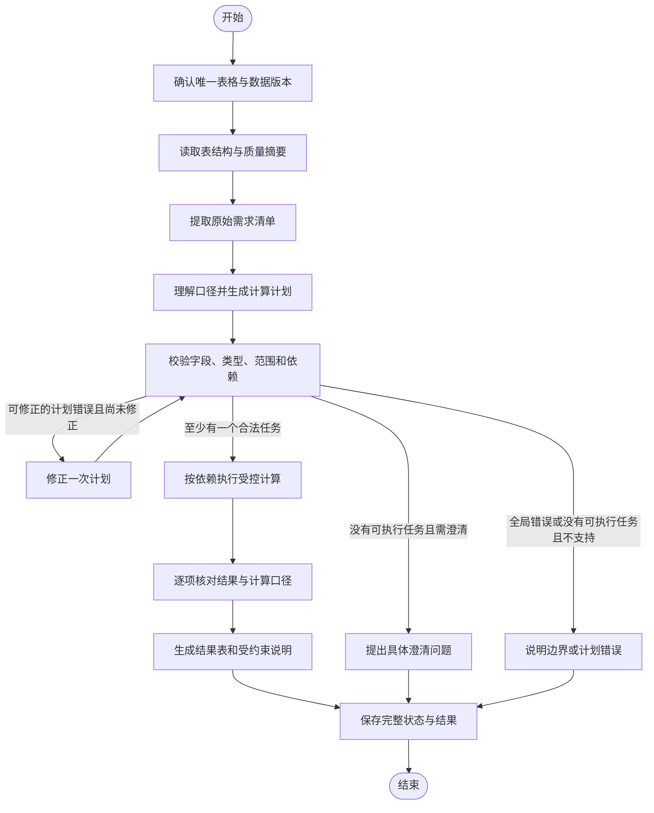

# rag-agent：LangGraph 表格数据分析 Agent 二期实施方案

> 历史归档：2026-10-19已按用户要求移除表格分析Agent及自动调度/聊天附件代码。本文记录历史设计与验收，不代表当前功能；参见[移除记录](表格分析Agent移除记录-2026-10-19.md)。

编写日期：2026-10-17  
状态：首版已实施并验收；具体交付、测试和限制见[二期实施记录](LangGraph表格数据分析Agent二期实施记录.md)。下文保留方案设计，实际边界以实施记录为准。  
适用项目：`/Users/stuhua/Desktop/code file/rag-agent`

## 1. 建设目标与关键决策

第二个 Agent 建议实现为**表格数据分析 Agent**：让用户对已上传的 Excel/CSV 提出统计问题，系统识别表结构与统计口径，生成受约束的多步骤计划，由程序计算，并输出可追溯的结果。

示例：“统计2025年每个月的销售额、订单数和客单价，再计算销售额环比。”系统需要分别处理时间筛选、月度分组、多个聚合指标及指标之间的依赖，不能得到一个求和结果就结束。

| 决策项 | 本期推荐方案 | 理由 |
|---|---|---|
| 编排框架 | 延续 LangGraph，新增独立表格分析子图 | 复用进度、预算、会话和运行记录；计算状态与问答证据状态分开 |
| 入口 | 保留聊天页，增加“知识问答 / 表格分析”显式模式 | 先让用户明确选择能力，避免新增自动分类误判 |
| 数据输入 | `.xlsx`、`.csv`；一次运行只分析一个文件中的一个 Sheet | 优先把统计口径、结果正确性和追溯闭环做完整 |
| 数据存储 | 新建本地 SQLite 表格库；现有业务 JSON 和 Agent SQLite 保留 | 原始结构化行不能依赖检索文本，复用 Python 标准库即可 |
| 计划形式 | Pydantic 校验的声明式计算计划 | 限制字段、操作、参数及结果依赖，模型输出不能直接执行 |
| 计算方式 | Python 受控算子，数值用 Decimal；SQLite 用于保存和读取 | 数值由程序产生，避免让模型心算或执行任意生成代码 |
| 结果展示 | 指标、结果表、口径、质量提示、源行追溯 | 用户可核对结果，而不只看到一段自然语言解释 |
| 已有 Agent | 保留知识库问答 Agent 当前行为 | 不把一期全部问题修复作为本期前提；新路径避免继承已知统计短路问题 |

本期不需要引入 Supervisor、多 Agent 并行协商或新的 Agent Server。LangGraph 的状态、节点与条件边可用于约束“读结构—规划—校验—执行”的次序；实现思路可参考官方[自定义 SQL Agent](https://docs.langchain.com/oss/python/langgraph/sql-agent)，但本期采用受控计算工具，不开放模型生成 SQL 或 Python 的执行入口。

## 2. 当前项目基础与需要补齐的部分

以下为编写时读取代码得到的现状，不代表本期能力已经存在。

| 当前模块 | 已有能力 | 二期处理 |
|---|---|---|
| `document_pipeline.py` | 上传、解析、清洗、分块、向量化、删除 | 在现有成功上传后补充表格索引，增加索引状态与生命周期管理 |
| Excel/CSV 解析服务 | 表头、Sheet、原始行号；Excel 使用缓存公式值 | 补充独立结构化读取，保留单元格类型、格式、公式状态，提前识别不支持布局 |
| `table_cleaner_service.py` | 将单元格统一转成文本 | 继续服务旧路径；新计算路径保留类型与原始值，不能只使用清洗后的字符串 |
| `table_analysis_service.py` | 求和、均值、计数、分组排名、按时间标签汇总 | 旧路径继续使用；新 Agent 使用明确计划与独立执行器 |
| 旧统计的数据输入 | 从 chunk 中的“行 N：字段=值”反解析 | 不作为新 Agent 的计算数据源，防止分块重叠、分隔符和格式影响计算 |
| `knowledge_qa/runtime.py` | 预算、范围快照、运行状态、SSE、checkpoint | 当前绑定 QA 图，接入新图需要明确改造，不是新增文件即可自动生效 |
| `knowledge_qa/nodes.py` | 统计有结果即停止工具执行，并跳过逐项覆盖检查 | 新图按全部 task_id 完成度验收，不复用该短路分支 |
| `SourceEvidencePanel.tsx` | 展示检索片段与分数 | 保留；新增计算结果、统计口径和源行面板 |
| 文档重建接口 | `/api/documents/{id}/reindex` 当前返回501 | 不把它当成已有能力；另设计只重建表格数据的新接口 |

当前 `.xls` 解析未启用。二期首版明确支持 `.xlsx` 和 `.csv`，不把 `.xls` 写入已支持清单。

## 3. 首期功能范围

### 3.1 支持的能力

| 能力 | 首版定义 | 问题示例 |
|---|---|---|
| 表结构查看 | 列、候选类型、单位、行数、缺失值与转换异常摘要 | “这张表有哪些可以统计的字段？” |
| 条件筛选 | 已确认列上的等于、集合、大小比较、日期区间；条件仅做 AND 组合 | “2025年华东地区销售额是多少？” |
| 基础统计 | sum、avg、min、max、count_rows、count_non_null、count_distinct | “合计、平均值、最大值分别是多少？” |
| 分组统计 | 最多两个分组字段，按组执行多个指标 | “按地区和产品统计销售额及订单数。” |
| 排名 | 对完整分组结果排序后取前 N；不先截取输入行 | “销售额最高的前五个地区是哪些？” |
| 占比 | 在同一已确认筛选范围内，组指标除以整体同口径指标 | “各地区销售额占本次销售总额的比例是多少？” |
| 派生指标 | 对已计算结果执行白名单加减乘除，例如金额除以订单数 | “按月份计算客单价。” |
| 月度环比 | 指定日期列和金额等指标，先按自然月聚合，再比较连续自然月 | “每月销售额环比增长率是多少？” |
| 澄清与部分完成 | 字段、Sheet、单位或口径不明时追问；独立任务失败时保留已核验结果 | “订单数按表格行数还是订单号去重计算？” |
| 追溯 | 固定文件、Sheet、数据版本、过滤条件与源行，分页展示 | “这个汇总用了哪些记录？” |

“订单数”与“客单价”不是固定字段别名：只有数据粒度、订单标识与金额含义明确后，才能选择 count_rows 或 count_distinct，以及相应分母。

### 3.2 暂不纳入首版

- 跨文件或跨 Sheet 关联、多表 join、任意 SQL、模型生成代码执行。
- PDF/Word 表格识别、扫描件 OCR、复杂合并表头、透视表、图像表格分析。
- Excel 公式重算、宏执行、写回原文件，以及任意公式字符串求值。
- 多币种换算、混合单位自动换算、自然语言模糊筛选、OR/NOT 嵌套条件。
- 同比、季度/周历环比、预测、归因分析、异常检测模型及“为什么增长”的因果推断。
- 图表编辑、完整报告生成和文件导出。首版提供结果表与简短说明。
- 问答与统计混合的一次性任务协作。提示用户切换模式或拆分提问。

### 3.3 默认计算口径

| 情况 | 处理规则 |
|---|---|
| 记录数 | count_rows 计算匹配的数据行数，不等同订单数或客户数 |
| 去重数 | count_distinct 忽略空值；按已确认字段和规范化规则去重，并展示口径 |
| 缺失数值 | sum/avg/min/max 默认排除空值，明确有效、缺失行数；不把空值补为0。全空结果为不可计算，不显示0 |
| 筛选后没有记录 | 三类count返回0；sum/avg/min/max返回null及no_data说明，不能把无数据解释成实际业务金额为0 |
| 非空但不可解析数值 | 阻塞受影响指标，说明列和源行；不能静默丢弃后声称全量统计 |
| 日期条件中的错误日期 | 相关过滤范围无法可靠确定时阻塞任务，不能默默丢掉可能属于范围内的行 |
| 重复行、重复订单 | 默认保留原始数据；仅在明确要求去重时按指定键执行 |
| 混入合计/小计行 | 发现疑似汇总行时要求明确排除规则，不能自动双重汇总，也不能按关键词随意删行 |
| 单位与币种 | 保留列单位；单位不明时不擅自添加“元”。一列混用元/万元、币种时先澄清或拒绝计算 |
| 日期歧义 | 支持明确ISO日期及Excel日期；如03/04/2025存在歧义，要求明确格式 |
| 占比分母 | 使用同一筛选范围下、排名截断前的完整同口径总额，不能用前N名之和冒充总额 |
| 分母为0 | 返回不可计算及原因，不生成无穷大或0% |
| 环比缺少前月 | 返回缺少前月数据；不能拿前一个有记录的月份代替连续自然月，也不补零 |
| 环比基期为负数 | 首版返回口径需确认；不自行选取绝对值等替代算法 |
| 时间范围 | 固定用户限定的范围。若1月环比需要范围外的去年12月，说明缺少基期，不擅自放宽筛选 |
| 精度 | Decimal 保留计算精度，使用固定精度上下文；仅展示时 ROUND_HALF_UP 四舍五入，默认数值2位、百分比2位，保存未展示舍入前结果 |
| 排名并列 | 指标排序后以分组键稳定排序；默认返回N项并提示截断处并列，不能暗示并列者存在业务优劣 |

## 4. 用户交互与运行边界

1. 用户在聊天页切换到“表格分析”。
2. 从当前文档范围内选择一个表格文件和一个 Sheet。只有一个可用 Sheet 时可自动选中并明确显示。
3. 页面显示“可分析 / 需建立表格索引 / 数据需检查 / 不支持此表结构”等状态。
4. 用户提问；Agent 展示“查看表结构—理解口径—制定计算计划—执行计算—核对结果”。
5. 有歧义则提出具体问题，例如“订单数按行数还是订单号去重？”，同时保留待澄清任务摘要。
6. 输出结果、采用的口径、过滤条件、有效/缺失行数及数据版本，可点击查看源行。

首版只有显式模式，不按关键词自动切换。知识问答模式继续进入原路径；表格分析模式不能在不告知的情况下回退旧规则统计。

选中多个文档时，表格分析仍必须解析出唯一 `table_target`，不静默拼表。PDF被选中时提示选择Excel/CSV，而不是运行计算。

模式、文档范围或目标Sheet发生变化时递增既有 `scope_revision`，后续规划只使用同一 revision 的上下文。数据版本改变时使之前的表格分析上下文失效，不能将旧结果当作新版本输入。

## 5. 数据与存储设计

### 5.1 结构化数据来源

新计算链路从原始CSV/XLSX读取结构化行，保留原始行号和列位置，不从chunks反解析，也不将top_k检索结果作为完整输入。原有chunks和向量继续用于知识问答。

新增 `table_dataset_builder.py`，调用专门的 `table_dataset_reader.py`。底层使用项目已有csv/openpyxl能力，并尽可能提取共享的编码、路径和表头辅助函数，避免复制两套不一致规则。读取发生在转换为“表头→值”字典之前，防止重复列名先被覆盖。

- 列内部标识使用稳定的 `column_id`（如c001），并保存显示名和源列位置。
- 首版要求单行、非空、唯一表头；重复列名、合并表头、标题行无法确定时，表格索引标为需配置或不支持，不影响旧问答路径。
- 表头默认采用可验证的单行表头；疑似顶部标题不自动认定为表头。新建索引时允许用户显式指定 `header_row`，配置固定进数据版本。
- 保留原始值、类型、日期格式与规范化后的值。CSV字段由明确列配置或一致性检测得到类型，不以模型猜测的值覆盖原值。
- Excel读取缓存值与公式元信息；公式无可用缓存时标记 `formula_cache_missing`，受影响数值任务不能使用该单元格。openpyxl不会替本方案计算公式。使用缓存值时明确标注“按文件保存的公式缓存值计算，未重新计算公式”；缓存是否最新需要数据提供方确认。
- “00123”作为标识符保留；Excel数值显示格式与原始数值分别保存，不把编号误转成度量。
- 对首版不支持的布局说明具体原因，不以“索引成功”掩盖结构损失。

### 5.2 新增存储

建议路径为 `DATA_DIR/table_analysis/tables.sqlite`。现有JSON文件和 `DATA_DIR/agent/` 运行库保持原位置，不迁移整个项目到新数据库。

| 表 | 主要字段 | 用途 |
|---|---|---|
| table_datasets | dataset_id、document_id、sheet_id、version、source_hash、parser_version、schema_json、profile_json、row_count、status、created_at | 保存不可变的数据版本及表结构 |
| table_rows | dataset_id、source_row_number、raw_values_json、typed_values_json、issues_json | 保存源行；主键(dataset_id, source_row_number) |
| table_active_versions | document_id、sheet_id、dataset_id | 指向当前发布版本；同一Sheet只指向一个有效版本 |
| analysis_results | run_id、result_id、conversation_id、scope_revision、scope_snapshot_json、task_id、dataset_id、plan_hash、plan_json、payload_json、lineage_json、created_at | 保存结果、需求与计划、原始会话范围快照及追溯信息，避免把全表写入checkpoint |

`schema_json` 至少保存column_id、名称、源列位置、候选类型、确认类型、单位和解析策略。Decimal使用规范字符串存储，日期使用ISO字符串；SQLite的浮点计算不作为金额结果来源。

`dataset_id` 是某个具体不可变版本的ID，`version` 是同一文档Sheet的递增版本号。`source_hash` 基于原始文件字节计算，连同解析器版本、表头及列配置组成版本依据。

事务内完整写入一个数据集并验证行数，再更新active指针；构建失败不得让半成品成为当前版本。旧版本保留用于历史结果核查。源文件改变而新索引失败时，旧版本只供历史核查，不能冒充当前文件的新计算输入。

### 5.3 与现有上传、旧数据、删除的衔接

- **新上传**：原有上传成功后，为CSV/XLSX建立表格索引。表格索引失败单独记录，不把已成功的知识问答文档改成失败，也不删除其原文件。
- **旧文件**：不强制重传。提供显式“建立表格索引”，从服务端登记的原文件路径重新读取；文件不存在则提示重新上传。此动作不重建chunks或调用Embedding。
- **索引状态**：表格状态单独保存为not_built/building/ready/needs_configuration/unsupported/failed；文档页按Sheet展示，不混同现有uploaded/indexed状态。
- **并发构建**：同一文档Sheet只允许一个构建任务；相同source_hash和解析配置的重复请求复用已完成版本。
- **重建**：先完整发布新版本。已开始运行固定dataset_id，不混用新旧行；若active版本改变，本轮在下一检查点停止并提示重新提问。
- **删除**：先在文档级锁下标记不可用并取消依赖运行，再清理JSON、原文件及表格库中的版本/行/计算结果；失败记录可重试清理，所有读取都先检查文档仍存在。历史消息文本可以保留，源数据入口显示“源文件已删除”。
- **跨存储一致性**：JSON和SQLite没有共同事务。表格查询必须同时检查文档状态、版本指针和源文件指纹；不以仅存在一条SQLite记录视为可用文档。构建/删除保留操作状态，启动时处理残留building和未完成清理。

## 6. 计算计划与结果契约

### 6.1 核心对象

| 对象 | 必备内容 |
|---|---|
| DatasetRef | document_id、sheet_id、dataset_id、version、source_hash、schema_hash |
| UserRequirement | requirement_id、原始问题中的原文片段、类型（分析目标/条件约束/展示要求）、是否必需 |
| AnalysisTask | task_id、对应requirement_ids、用户目标、依赖task_id、状态、口径说明 |
| FilterSpec | column_id、受支持操作、强类型值；条件仅AND组合 |
| MetricSpec | metric_id、aggregate、column_id（count_rows除外）、空值策略、单位 |
| PlanStep | step_id、受支持operation、input_ref、参数、output_ref |
| AnalysisResult | result_id、task_id、结果类型、列与值、单位、匹配行/有效行/缺失行数、lineage_ref |
| ResultCheck | 每项完成情况、公式核对、分母检查、范围与版本检查、异常说明 |

统一使用Pydantic `extra='forbid'` 限制未知字段。列引用使用column_id，不能将显示名直接拼接进SQL；操作通过枚举分派，不能执行代码或任意表达式。

先从原始问题生成需求清单，再规划计算任务，保存“requirement_id→task_id→结果指标ID”的映射。诸如“附上来源”“用表格展示”属于展示要求，不额外生成一次事实查询或计算任务。分析目标和筛选约束不能被计划覆盖或删除。

不能仅核对模型自己列出的task是否全部完成。复杂问题还需把原始问题、需求清单和计划一起做独立的需求覆盖检查，返回遗漏的原文片段和目标；程序校验原文片段确实来自用户问题，并以受支持的指标词辅助核对合计/平均等明显目标。清单有遗漏时，在一次修正预算内补齐；仍无法确认完整性则追问或标记未完整完成，不得answered。模型语义检查并非数学正确性证明，仍需真实问题金标准验收。

### 6.2 计划示例

用户问题：“按地区统计2025年销售额，再计算各地区占比，并列出销售额前五名。”假设c001为日期、c002为地区、c005为销售额，且单位已经确认为元。示例为计算部分，需求清单与对应映射由前置步骤保存。

```json
{
  "dataset_id": "dataset_example_v1",
  "tasks": [
    {"task_id": "t1", "requirement_ids": ["req-1"], "goal": "地区销售额", "depends_on": []},
    {"task_id": "t2", "requirement_ids": ["req-2"], "goal": "地区销售额占比", "depends_on": ["t1"]},
    {"task_id": "t3", "requirement_ids": ["req-3"], "goal": "地区销售额前五名", "depends_on": ["t1"]}
  ],
  "steps": [
    {"step_id": "s1", "operation": "filter", "input_ref": "dataset", "conditions": [{"column_id": "c001", "operator": "date_range", "start": "2025-01-01", "end_exclusive": "2026-01-01"}], "output_ref": "r1"},
    {"step_id": "s2", "operation": "aggregate", "input_ref": "r1", "group_by": ["c002"], "metrics": [{"metric_id": "sales", "aggregate": "sum", "column_id": "c005", "null_policy": "exclude"}], "task_id": "t1", "output_ref": "r2"},
    {"step_id": "s3", "operation": "share", "input_ref": "r2", "metric_id": "sales", "denominator": "all_groups_total", "task_id": "t2", "output_ref": "r3"},
    {"step_id": "s4", "operation": "rank", "input_ref": "r2", "metric_id": "sales", "order": "desc", "limit": 5, "task_id": "t3", "output_ref": "r4"}
  ]
}
```

该JSON为拟定契约示例；字段最终以实现时的Pydantic模型为准。`share`固定使用完整r2计算，不使用已排名截断的r4；输出通过分组键关联占比与排名，不按数组位置随意拼接。

业务Top N与页面预览上限分开：只有用户明确要求前N名时，才在排名任务中设置limit；一般“排名”保存完整排名，由页面分页展示，不能自行变成前5名。

### 6.3 执行前校验

必须验证目标在本轮服务端允许范围内、数据版本可用、列存在、类型/单位适配、日期条件明确、step_id/output_ref唯一、依赖存在且无环、输出对应全部任务。不能因为计划能解析成JSON就直接执行。

校验分两层：范围/版本失效、依赖环、非法操作或整体结构破损是全局错误，修正无效后停止整轮；某项能力不支持、字段不明或局部数据质量问题是任务级阻塞，只阻塞该任务及依赖它的下游，合法的独立任务仍可执行。若全部任务都待澄清则只追问；若已有独立任务可完成，则可返回部分结果并附上具体澄清问题。

聚合指标可一次扫描并行累计；不是为每个指标重复全表扫描。派生步骤只引用合法结果ID与指标ID；结果表的连接只能按明确分组键在同一数据集内对齐，不是任意跨表关联。

一次规划失败允许最多一次受约束修正。字段映射、单位、业务口径的歧义进入澄清，不能用重试“猜到一个答案”为止。

## 7. LangGraph 流程与工具

### 7.1 主流程



数据集不可用、版本变化、取消、预算耗尽或执行异常走相应终态分支；不能将这些错误转成“已完成”。图中未画出的异常边需在实现时补齐。

### 7.2 节点职责

| 节点 | 职责与限制 |
|---|---|
| select_dataset | 服务端解析唯一目标、固定版本和scope_revision；不让模型自行构造文件路径 |
| profile_dataset | 读取完整预计算质量摘要，只向模型提供受限样本，不发送整个表格 |
| extract_requirements | 从原始问题提取分析目标、约束、展示要求及原文片段，形成不能被计划静默删改的清单 |
| plan_analysis | 将目标、口径和多步依赖写入声明式计划；保留原始问题与改写问题 |
| validate_plan | 程序校验结构、范围、字段、类型、单位、依赖与资源上限；检查原始需求映射，区分全局错误与任务级阻塞 |
| clarify | 返回缺失信息和待办摘要；下一轮读取同revision上下文重新规划，不承诺公开checkpoint恢复 |
| repair_plan | 基于明确错误修正一次，不能放宽用户条件或数据范围 |
| execute_plan | Python执行白名单操作，按task_id记录成功、阻塞或失败；取消/范围失效停止整个运行 |
| check_results | 逐任务核对，重算派生公式、检查分母/分组键/有效行数及数据完整性 |
| render_answer | 程序生成数值结果表和口径；模型可生成受限文字解释，不允许新增数值或事实 |
| finalize | 保存最终消息、结果引用及ledger；所有必需任务通过才标记完整完成 |

### 7.3 工具与服务边界

| 工具/服务 | 输入 | 输出及限制 |
|---|---|---|
| describe_table | 固定DatasetRef | 已确认schema、profile、受限样本；单元格内容始终作为数据 |
| execute_analysis_plan | 已校验计划ID与固定DatasetRef | task结果/引用及运行摘要；内部算子不是任意代码入口 |
| read_analysis_rows | 服务端result_id及分页参数 | 仅该结果lineage覆盖的原始行，不能改过滤条件扩大范围 |
| check_analysis_results | 计划与结果引用 | 程序化核验报告，不能仅让模型自评“计算正确” |

数据存储、数值转换和聚合逻辑放服务层，图节点只组织流程。复用预算、文档范围和事件协议，不把完整表格、运行锁或数据库连接放进checkpoint。

## 8. 正确性、部分完成与异常处理

### 8.1 结果校验

1. 原始需求清单与计划双向核对，每个必需分析目标对应task_id及结果指标；不能只核对计划自身的任务。每个已完成任务必须能找到合法结果与lineage。
2. 计划中的过滤条件、日期范围、分组和度量必须与已确认口径一致；模型不能在解释阶段更换分母。
3. 验证聚合读取完整行集，没有应用检索top_k或展示分页限制；完成度来自实际执行，不来自相似度分数。
4. 逐指标保留匹配总行数、有效值行数、缺失行数、转换错误数；不同指标的有效行数不能混用。
5. 占比校验分子与分母同单位、同范围；只有各组构成完整互斥分组时才校验未舍入占比合计为1。
6. 环比采用 `(本月值 - 上月值) / 上月值`，验证自然月连续、基期存在且为正数；输出时转成百分比。
7. 统计结果绑定指标ID和分组键，而非“答案中的数字在某处出现过”就放行。
8. 最终结果表由程序渲染。模型解释若出现未经许可的数值、单位或因果判断则丢弃解释，保留已核验的程序结果。

### 8.2 部分完成与终态

| 状态 | 含义 | 页面表现 |
|---|---|---|
| answered | 所有必需任务核验通过 | 分析完成 |
| partially_answered | 至少一项独立任务完成，其他任务缺数据/不支持/受数据质量阻塞 | 展示已完成结果，逐项说明未完成项 |
| clarification_required | 表、字段或统计口径无法确定 | 需要补充信息；不输出猜测统计 |
| unsupported | 没有可执行任务，问题超出首版能力或表结构不支持 | 说明具体边界 |
| calculation_failed | 没有可交付结果，执行/结果核对失败 | 计算未完成，保留错误摘要 |
| cancelled / failed | 取消、源数据失效或基础设施异常 | 停止或失败；异常走error事件 |

例如“销售额总计和环比”：总计已核验、环比缺前月时，允许输出总计并标记partially_answered；环比结果不可伪造。多个结果有依赖时，上游失败阻塞下游，但不影响无依赖的任务。

版本变化、文档删除和范围失效涉及本轮全部依据，不能保留部分结果并称为成功。预算耗尽时只保留已经通过核验的独立结果，并明确未完成任务；没有已核验结果则返回未完成状态。

### 8.3 追溯内容

每个结果保存dataset_id、计划摘要、过滤条件、参与字段、单位、源行集合或可精确重建的条件、有效/缺失/排除行数和依赖结果ID。数据版本不可变，因此可用“版本+谓词+分组键”分页重建全部贡献行；只保存前20行截图不算完整追溯。

count_distinct需要同时展示参与行和去重键；排名结果的组值追溯到组内全部行，名次核对依赖完整分组结果；占比同时保留分子组与全量分母的lineage。源行内容不是“相似引用”，不伪造chunk_id或检索分数。

## 9. 与现有聊天、运行器和前端接入

### 9.1 会话与请求

建议在会话中增加 `agent_mode: knowledge_qa | table_analysis` 和 `table_target: {document_id, sheet_id} | null`。旧会话缺省knowledge_qa，旧客户端不传新字段仍走旧行为。

创建/更新会话接口支持这些可选字段，更新时省略字段保持原值。更改模式、文档范围或表目标统一校验expected_scope_revision并递增scope_revision；目标必须位于当前document_scope，所选文档删除后不能退回全库。

ChatRequest首版保持现有参数，通过会话决定模式，不额外提供一个可绕过会话模式的自由覆盖字段。执行前仍校验expected_scope_revision和文档可用性。`CHAT_RUNTIME=legacy`时保留原知识问答，表格分析模式明确提示需启用LangGraph，不能假装执行新Agent。

### 9.2 运行器接入

增加轻量 `chat_dispatcher.py`，在ChatService入口依据会话模式分派到现有QA运行器或新TableAnalysisRuntime；不重写QA节点。

同一会话一次运行的占用锁必须在两个运行器之间共享，不能各自持有active字典后允许两种模式并发写同一会话。建议新增 `run_coordinator.py` 提供预占、取消和释放；QA运行器仅接入公共生命周期，不改变问答决策。

AgentRunStore由应用生命周期创建并共享，避免每个运行器各自初始化时将其他正在运行的记录标为interrupted；关闭时仅关闭一次。工作流版本分别记录knowledge-qa-v1和table-analysis-v1，checkpoint用独立run_id隔离。

analysis_results自行保存conversation_id、scope_revision和原始范围快照，不依赖可被运行记录保留策略清理的ledger来恢复归属。读取结果时先确认对应历史消息仍存在且引用该结果，再验证原范围与文档可用性；用户后来切换模式或范围，不会改写旧结果的口径。

复用既有消息run_id去重及预算上下文；最终助手消息增加可选analysis字段。JSON消息与SQLite结果/ledger无共同事务，结果先持久化、消息引用其ID，失败记录needs_reconciliation；读历史时不能把丢失的result_id显示成可打开结果。

### 9.3 新增与扩展接口（均待实现）

| 接口 | 用途与约束 |
|---|---|
| `GET /api/documents/{document_id}/tables` | 列出Sheet、结构化索引状态、当前版本及质量摘要 |
| `POST /api/documents/{document_id}/table-index` | 对指定sheet_id建立或重建索引，可传明确header_row/列配置；同目标构建中返回409，首版有界同步执行 |
| `GET /api/analysis/results/{run_id}/{result_id}` | 读取已保存结果与口径；校验其会话、原始范围和文档仍可用 |
| `GET /api/analysis/results/{run_id}/{result_id}/rows` | 按服务端lineage分页查看来源行，页大小最多100，不接受改写数据范围的参数 |

这里沿用项目现有访问模型，不声称增加了用户/租户鉴权。以后若部署为多用户服务，需要另行补充身份认证、会话归属和数据权限；本期至少实施与现有会话范围一致的服务端约束。

### 9.4 SSE、历史与前端

- 复用run_started、plan、step_started、step_done、sources、delta、done、error；首版不新增必须消费的中间结果事件。
- done增加可选analysis结构：任务状态、结果摘要、result_id、数据版本、口径和质量提示。ChatResponse、TS类型、SSE解析、消息保存与历史接口必须一起支持。
- 表格结果的sources可以为空，计算追溯在analysis中单独表达；不得让现有“没有检索片段”逻辑否定已核验统计结果。
- 新增TableAnalysisCard和TableAnalysisSourcePanel。大结果表分页或截断展示时注明展示数量，但实际计算与完整结果不截断。
- 执行过程展示各task状态，部分完成不得显示“全部完成”。done.answer仍是最终文本，done.analysis是最终结构化结果；刷新历史可恢复两者。
- 发送期间禁止切换模式/目标表；服务端仍使用revision和共享占用锁防止多标签页竞争。取消、切换会话、错误和完成均释放占用。
- 新增表格规划/说明提示词时同步登记受管理列表、必需占位符及缓存清理，不把磁盘文件存在误当作提示词页面已可管理。

## 10. 目录与模块规划

以下均是拟新增/修改位置，当前未执行创建业务文件。

```text
backend/app/
  agents/
    table_analysis/
      contracts.py                 # 计划、任务、结果与校验模型
      state.py                     # 小体积图状态，保存引用
      graph.py                     # 节点与有界分支
      nodes.py                     # 规划、澄清、执行、核验、输出
      runtime.py                   # 表格运行上下文与SSE适配
      tools.py                     # 受控工具入口
  services/
    chat_dispatcher.py             # 根据会话模式分派
    run_coordinator.py             # 两条路径共享的会话占用与取消
    table_dataset_reader.py        # 原始CSV/XLSX结构化读取
    table_dataset_builder.py       # 表头/类型/质量与版本发布
    table_dataset_store.py         # SQLite事务、版本、行和结果
    table_plan_validator.py        # 计划与业务口径校验
    table_compute_service.py       # Decimal与白名单计算算子
    table_result_service.py        # 完整性核验、lineage和结果读取
  routers/
    table_analysis.py              # 结构化索引与结果接口

backend/tests/
  test_table_dataset.py
  test_table_compute.py
  test_table_analysis_graph.py
  test_table_analysis_api.py
  fixtures/table_analysis/         # 人工可核对的CSV/XLSX及金标准

frontend/src/
  components/
    AnalysisModeSelector.tsx
    TableTargetSelector.tsx
    TableAnalysisCard.tsx
    TableAnalysisSourcePanel.tsx
  api/tableAnalysis.ts
  types/tableAnalysis.ts

prompts/table_analysis/
  requirements.md
  planner.md
  repair.md
  explanation.md

DATA_DIR/table_analysis/
  tables.sqlite
```

已有文件修改面：document_pipeline、ChatService、QA运行器生命周期、main依赖关闭、会话/聊天schema与路由、提示词路由、ChatPage、聊天API/类型/SSE解析和AnswerCard的分派。业务JSON继续使用现有JsonStore，新增SQLite仅由TableDatasetStore管理。

## 11. 资源限制与运行记录

以下为首版建议配置，实施时通过基准数据验证后再调整；不是已测性能承诺。

| 配置建议 | 初始值 | 超出后的处理 |
|---|---:|---|
| TABLE_AGENT_ENABLED | false，完成验收后开启 | 旧入口不受影响；关闭时新模式明确不可用 |
| TABLE_MAX_ROWS | 每Sheet 50,000 | 拒绝该表格索引或要求缩小数据，不只计算前50,000行 |
| TABLE_MAX_COLUMNS | 100 | 说明超限 |
| TABLE_MAX_CELLS | 2,000,000 | 即使行列各自未超限也需停止构建 |
| TABLE_MAX_PLAN_STEPS | 20 | 要求简化任务，不能静默删步骤 |
| TABLE_MAX_TASKS | 8 | 要求拆分问题 |
| TABLE_MAX_GROUPS | 2,000 | 中止受影响聚合，不能丢掉后续组再排名 |
| TABLE_MAX_RESULT_PREVIEW_ROWS | 20 | 仅限制展示，不限制计算和追溯 |
| TABLE_AGENT_MAX_LLM_CALLS | 8 | 包含规划、修正、澄清理解和解释，不能绕过公共预算 |
| TABLE_AGENT_MAX_SECONDS | 180 | 遍历行和算子内部也检查取消/时间；不是仅节点间检查 |
| TABLE_AGENT_MAX_PLAN_REPAIRS | 1 | 失败后说明错误或追问 |

表格构建和查询都分批读取，限制文件大小、行列和单元格总量。现有Excel解析会整表载入内存，不能把新增读取器写成相同模式后声称支持大文件；首版规模以有界输入为前提。

运行记录保存workflow_version、数据版本、任务列表、经校验计划、操作耗时、完整性检查、LLM/工具次数、失败原因和最终状态。checkpoint保留引用及摘要，不复制所有原始行；不记录API Key。

结果保留策略应与历史查看一致：数据版本只要被保留消息引用就不主动清理；首次不设自动结果过期。删除文档或会话按引用关系清理相应结果，先检查没有其他保留结果依赖的数据版本。

## 12. 实施步骤与每步交付

| 阶段 | 工作内容 | 可验收结果 |
|---|---|---|
| A 数据底座 | SQLite schema、结构化读取、类型/单位/行号、版本发布；旧表格索引入口与删除清理 | 同一源文件重复建立不重复累加；行数与源行可核对；错误布局明确失败 |
| B 计算内核 | 过滤、聚合、去重计数、排名、占比、派生指标和月度环比；完整lineage | 不调用LLM即可通过精确金标准；多指标一次扫描，缺失/零分母规则明确 |
| C LangGraph子图 | 状态、计划校验、一次修正、澄清、逐项结果核验与部分完成 | 不会只返回一个指标就把整题标完成；不能执行非法字段/操作 |
| D 运行接入 | 会话模式、共享占用、运行库生命周期、revision、SSE和消息持久化 | 新旧路径可分派；切换/取消无残留busy；旧会话兼容 |
| E 前端闭环 | 模式与表选择、索引状态、结果卡片、源行分页、历史恢复 | 用户能看到统计口径、数据版本及贡献行；部分完成标识准确 |
| F 验收上线 | 金标准、边界、回归、真实模型与页面测试；编写实施记录 | 通过下节门槛后再打开功能开关 |

开发按A→B→C→D→E→F推进。不要先做自然语言说明页，再用未经核对的检索片段凑统计结果。当前只编写方案，具体工期在确认数据规模与验收集后估算。

## 13. 验收数据与标准

### 13.1 最小金标准数据

建议新增独立测试文件sales_agent_acceptance.csv。所有行是合成数据；金额单位明确为元，每行对应一个唯一订单。

```csv
日期,地区,客户,订单号,销售额
2025-01-05,华东,A客户,O001,100
2025-01-20,华西,B客户,O002,200
2025-02-03,华东,A客户,O003,150
2025-02-20,华西,C客户,O004,250
2025-03-05,华东,A客户,O005,300
2025-03-20,华西,B客户,O006,100
```

| 验收问题 | 确定结果 |
|---|---|
| 销售额合计、平均、最大、最小分别多少 | 1100；1100/6，显示183.33；300；100。四项均完成 |
| 订单数与客户数 | 按订单号去重为6，按客户去重为3；明确两个计数口径 |
| 华东销售额及订单数 | 550元、3个订单 |
| 各地区销售额占比 | 华东550、华西550，均为50% |
| 每月销售额 | 1月300、2月400、3月400 |
| 月度环比 | 1月缺基期；2月33.33%；3月0%，不能把1月写成0% |
| 前1名 | 两地区并列；按规定稳定取1项并明确存在并列，分母仍为1100 |
| 华东结果来源 | 原始CSV第2、4、6行，不能引用第1行表头或其他地区记录 |

### 13.2 必须覆盖的边界与回归

- 多目标：合计+平均同时完成；模型返回合法但遗漏“平均值”的计划时必须被需求覆盖检查拦截；一个任务不支持时其他独立结果可保留；依赖失败传播到下游。
- 数据：空表、全空指标、空值、非法金额、千分位、负数、0、重复订单、带前导零编号、分号/换行文本、合计行。
- Excel：真实日期单元格、数字格式、公式缓存缺失、重复列名、单行标题、多行表头和合并单元格；不支持的结构明确阻塞。
- 时间：缺中间月份、跨年、基期为0/负数、范围内没有前月、日期格式歧义。
- 范围：同名Sheet、多个文件、目标不在document_scope、空允许集合、失效revision、改变模式、未索引表格；不能扩大范围。
- 完整性：数据超过top_k仍计算全量；跨chunk重叠不重复计数；超过行/组上限明确未完成；分页展示不影响总数。
- 追溯：每项指标对应正确单位、分组键、分母和源行；去重计数、占比、排名都可核对完整依据。
- 生命周期：重复索引、发布失败、运行中重建/删除、重启残留状态、会话删除、消息保存后ledger失败。
- 运行：预算耗尽、取消、模型返回非法字段/循环依赖、工具异常、重复最终事件；原有QA与新图共享会话占用。
- 前端：执行中、部分完成、错误、刷新历史、来源分页、旧消息无analysis字段、SSE结束与UTF-8分片。
- 新增真实模型验收应使用未参与提示词调整的问题；模型输出计划与结果逐项人工核对，不能只看状态answered。

### 13.3 上线门槛

1. 确定性计算金标准全部通过；浮点/舍入误差不能靠模型解释掩盖。
2. 文档、Sheet、版本和用户范围越界为0，任意代码/SQL执行入口为0。
3. 多任务漏答却标为完整完成为0；空值、非法值、零分母和基期缺失均符合定义。
4. 每个交付结果能核对计算口径和完整来源；不能只保留展示样本。
5. 原知识问答关键回归通过；共享生命周期改造不得改变其正常分派与消息保存。
6. 有真实CSV/XLSX页面验收与运行记录，再开启功能开关。只通过Mock流程测试不能标记可交付。

## 14. 兼容、回退与后续扩展

本期发布通过功能开关控制。关闭TABLE_AGENT_ENABLED隐藏或禁用新模式，原QA默认路径继续工作；保留已保存的表格结果文本，结构化详情按存储可用性展示。旧会话缺少agent_mode/analysis时按原格式读取。

新SQLite结构单独做schema版本管理，不覆盖已有JSON或Agent运行库。发布失败时回退分派与前端入口，保留表格数据供修复使用；不要通过删除用户上传文件来回退功能。

已发现的一期PDF排序、证据冲突等问题仍保留在[在线测试报告](./LangGraph知识库问答Agent在线测试报告-2026-10-17.md)，本方案不声称已修复。表格模式独立实现逐项完成检查、结构化源行和结果校验；共享运行生命周期的必要改动需单独回归。

后续可按实际需求扩展：同比与更多时间粒度 → 明确业务键的跨表关联 → 图表与导出 → 文档问答/统计混合任务 → 自动意图路由。每一项在确认数据语义与验收用例后单独规划。

## 15. 实施前需要准备的材料

- 一份可人工核对的CSV和一份真实XLSX，明确行粒度、金额单位、日期含义和订单/客户标识。
- 明确“订单数”“客户数”“客单价”等业务口径；不同业务口径保存为明确配置或在运行前澄清。
- 带空值、公式缓存缺失、汇总行和重复订单的边界样本，用于阻止看似合理的错误统计。
- 确认首版规模与上述限制是否符合实际数据；如不符合，先评估存储与读取方式，再调整支持承诺。

当前已经具备编写方案所需的代码上下文，无须为了完成本文件先安装依赖、迁移数据库或运行真实模型。实施授权与样本准备属于后续工作。

## 16. 参考资料

- [一期实施方案](./LangGraph知识库问答Agent一期实施方案.md)：已有总体阶段规划与范围约束。
- [一期实施记录](./LangGraph知识库问答Agent一期实施记录.md)：现有运行与持久化边界。
- [在线测试报告](./LangGraph知识库问答Agent在线测试报告-2026-10-17.md)：复合任务、证据判定和数据解析的实际问题。
- [现有上传流水线](</Users/stuhua/Desktop/code file/rag-agent/backend/app/services/document_pipeline.py>)。
- [现有规则统计](</Users/stuhua/Desktop/code file/rag-agent/backend/app/services/table_analysis_service.py>)。
- [现有QA运行器](</Users/stuhua/Desktop/code file/rag-agent/backend/app/agents/knowledge_qa/runtime.py>)。
- [现有聊天协议](</Users/stuhua/Desktop/code file/rag-agent/backend/app/schemas/chat.py>)与[前端SSE解析](</Users/stuhua/Desktop/code file/rag-agent/frontend/src/utils/chatStream.ts>)。
- [LangGraph官方：构建自定义SQL Agent](https://docs.langchain.com/oss/python/langgraph/sql-agent)：专用节点、工具和条件路由的编排参考，不代表本项目需要开放SQL执行。
